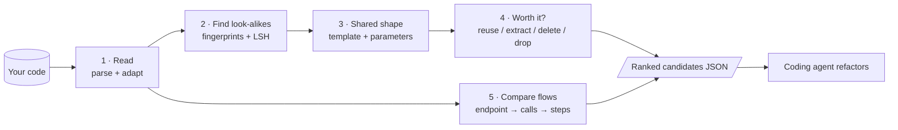
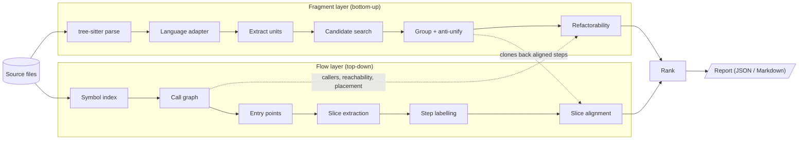
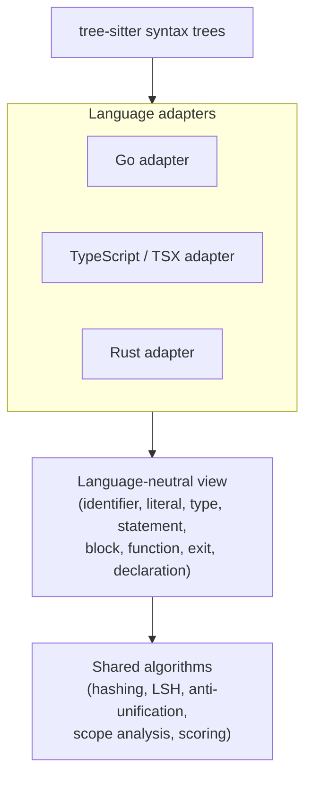
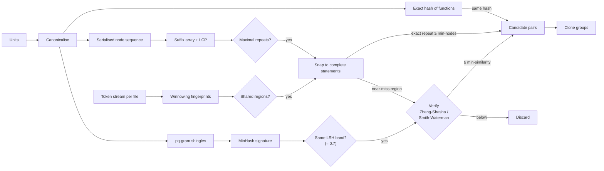
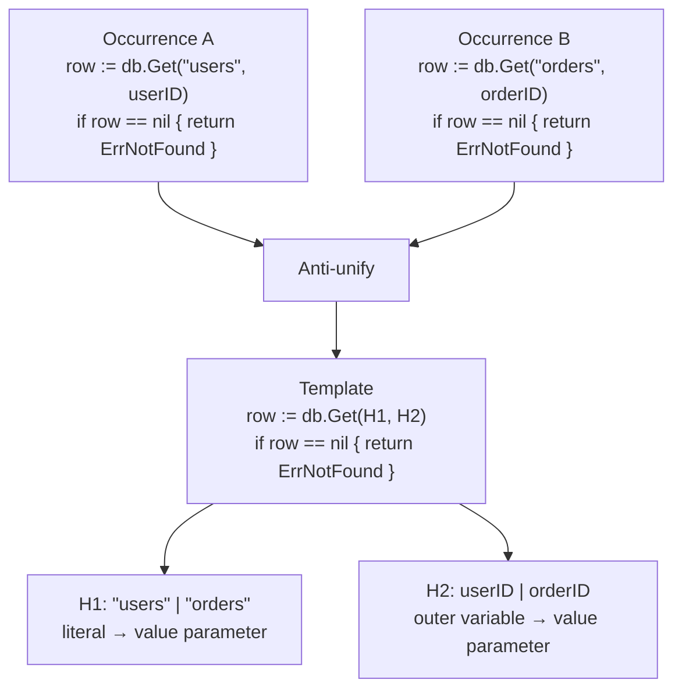
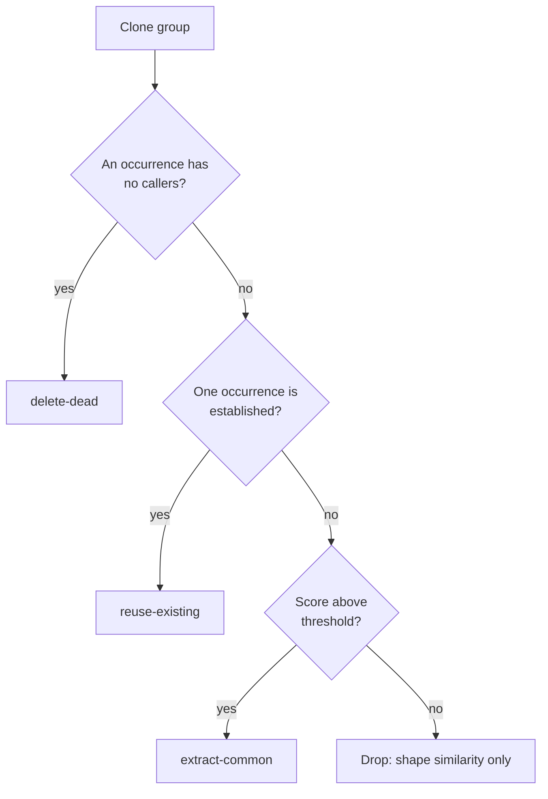
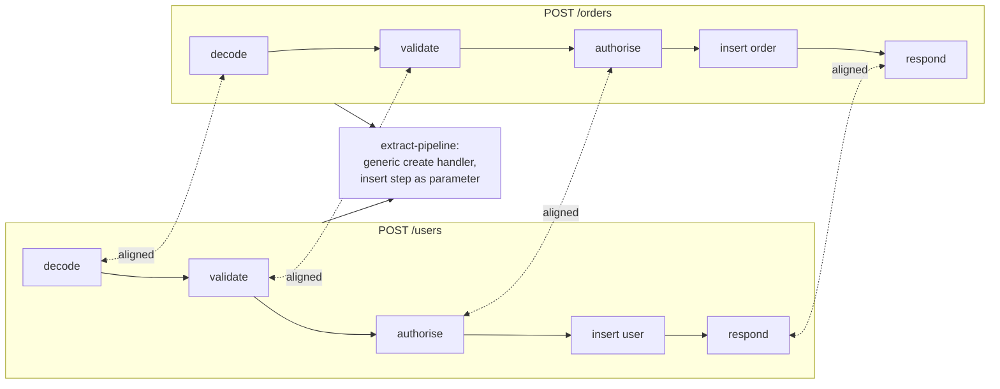
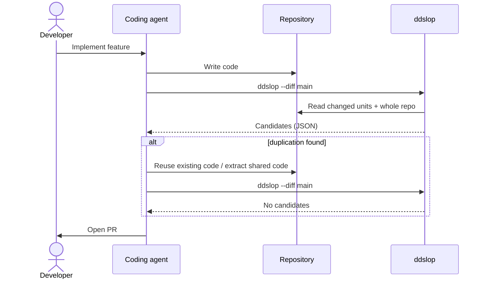
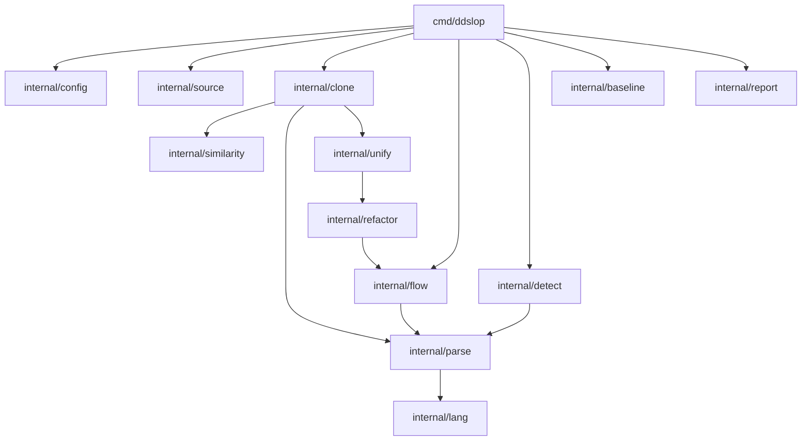

# ddslop architecture

ddslop finds duplicated code in Go, TypeScript and Rust codebases and proposes
refactoring candidates. It is aimed at "de-slopping" AI-generated code, and
its output is meant to be consumed by coding agents (Claude Code, Codex), not
primarily by humans.

ddslop never rewrites source files. It produces precise, self-contained
candidates; the agent decides and performs the refactoring.

## Goals and non-goals

Goals:

- Find duplication that AI agents typically produce, including code that was
  regenerated rather than copy-pasted.
- Turn raw similarity into actionable refactoring candidates: what to extract
  or reuse, with which parameters, and where to put it.
- Find duplicated *flows* (for example, every endpoint re-implementing the same
  decode, validate, query, respond pipeline), not only duplicated fragments.
- Be fast enough to run on every agent change (diff mode).

Non-goals:

- Applying refactorings automatically.
- Deciding semantic equivalence with certainty. The tool proposes; the agent
  judges.
- Cross-language duplication (for example, a TypeScript frontend and a Go
  backend sharing validation logic). Each language is analysed on its own.

## How AI code gets duplicated

Humans copy-paste, so human clones are close to identical. Agents regenerate
code, so their duplication is structurally similar but rarely token-identical.
The patterns ddslop targets:

| Pattern | Example | Clone type |
| --- | --- | --- |
| Reinvented helper | new `formatUserName()` next to existing `formatName()` | 3–4 |
| Parallel siblings | `handleCreateUser` vs `handleCreateOrder` | 2–3 |
| Duplicated pipelines | every endpoint re-implements decode → validate → query → respond | flow-level |
| Duplicated types | `UserDTO`, `UserResponse`, `UserData` with the same fields | structural |
| Scattered constants | the same timeout or URL literal in many files | literal |
| Reinvented stdlib | hand-written `contains`, `min`, `chunk`, `retry` | 3–4 |
| Stale versions | `parseConfig` and `parseConfigV2` both present, one unused | 2–3 |

The clone types in the last column are explained in the next section.

## Clone types

Clone research sorts duplicated code into four numbered types, from "exact
copy" to "same behaviour, different code". Each type is harder to detect
than the one before, and needs a different refactoring. ddslop also uses
three extra categories for duplication that is not about function bodies.

All examples below are variations of this Go function:

```go
func sumPositive(nums []int) int {
	total := 0
	for _, n := range nums {
		if n > 0 {
			total += n
		}
	}
	return total
}
```

### Type 1: exact copy

The code is identical except for whitespace, formatting and comments.

```go
func sumPositive(nums []int) int {
	total := 0 // running sum
	for _, n := range nums {
		if n > 0 { total += n }
	}
	return total
}
```

- **Typical cause:** plain copy-paste. Rare in AI code, because agents
  regenerate rather than copy.
- **Detection:** hash the syntax tree; formatting and comments are not part
  of it. Cheap and exact.
- **Refactoring:** delete one copy and call the other (`reuse-existing`).

### Type 2: renamed or parameterised copy

Same structure, but identifiers, literals or types differ.

```go
func sumLarge(amounts []int) int {
	sum := 0
	for _, a := range amounts {
		if a > 100 {
			sum += a
		}
	}
	return sum
}
```

Two kinds of difference matter here:

- **Consistent renaming** (`total` → `sum`, `n` → `a` everywhere). These are
  local naming choices and do not need parameters.
- **Changed literals, types or outer names** (`0` → `100`). These change
  behaviour and become parameters: `sumAbove(nums []int, min int) int`.

- **Typical cause:** parallel siblings such as `handleCreateUser` and
  `handleCreateOrder`, or one agent session adapting another's code.
- **Detection:** hash the syntax tree with identifiers and literals replaced
  by placeholders. Still cheap and exact.
- **Refactoring:** `extract-common` with the changed values as parameters,
  or `reuse-existing` if one copy already takes them as parameters.

### Type 3: near-miss copy

Mostly the same, but statements were added, removed or changed. Usually
combined with type 2 renaming.

```go
func sumPositive(nums []int) int {
	total := 0
	for _, n := range nums {
		if n > 0 {
			log.Printf("adding %d", n)
			total += n
		}
	}
	return total
}
```

- **Typical cause:** the most common AI pattern. An agent rewrites a helper
  from scratch and adds its own logging, checks or error handling.
- **Detection:** hashes no longer match. ddslop compares vectors of node-kind
  counts with LSH to find near matches, then confirms them with tree edit
  distance and a similarity threshold.
- **Refactoring:** harder. The extra statements become optional behaviour (a
  function parameter or an option), or the agent decides the extra statement
  was unnecessary and drops it.

### Type 4: same behaviour, different code

The code does the same thing but is written differently: other control
flow, other library calls, a different algorithm.

```go
func sumPositive(nums []int) int {
	total := 0
	for i := 0; i < len(nums); i++ {
		total += max(nums[i], 0)
	}
	return total
}
```

- **Typical cause:** an agent reinventing a helper it did not know existed,
  or reimplementing standard library functions.
- **Detection:** syntax comparison mostly fails. Partly covered by the
  stdlib catalogue and the flow layer; code embeddings are planned for later.
  Proving true equivalence is undecidable in general, so ddslop only flags
  likely cases and leaves the judgement to the agent.
- **Refactoring:** usually `reuse-existing`: keep the better version.

### Other categories

| Category | What is duplicated | Example | Detected by |
| --- | --- | --- | --- |
| Flow-level | a sequence of steps across several functions | every endpoint does decode → validate → query → respond | flow layer |
| Structural | type declarations | `UserDTO` and `UserResponse` with the same fields | duplicate type detector |
| Literal | constant values | the same timeout or URL in many files | repeated literal detector |

### Summary

| Type | What differs | Detection method | Cost | Planned for |
| --- | --- | --- | --- | --- |
| 1 | formatting, comments | syntax tree hash | low | v1 |
| 2 | names, literals, types | normalised syntax tree hash | low | v1 |
| 3 | added, removed or changed statements | LSH + tree edit distance | medium | v1 |
| 4 | the implementation itself | stdlib catalogue, flow layer, embeddings | high | v2 and later |
| Flow-level | which functions, same steps | call graph + slice alignment | high | Go prototype, then v2 |
| Structural | type names | field-set comparison | low | v2 |
| Literal | location only | literal index | low | v2 |

## How it works

A run of ddslop goes through five steps:

1. **Read the code.** Every Go, TypeScript and Rust file is parsed into a
   syntax tree. A small adapter per language translates the tree into a
   common vocabulary (identifier, literal, statement, function, ...), so the
   rest of the tool does not care about the language.
2. **Find look-alikes.** Functions and runs of statements are fingerprinted
   with names and values blanked out. Identical fingerprints are exact or
   renamed copies; similar fingerprints (via LSH) are near-copies that are
   then verified properly.
3. **Work out the shared shape.** For each group of look-alikes, ddslop
   lines up the copies and keeps what they have in common as a template. The
   places where they differ become the parameters of a shared function.
4. **Check it is worth it.** It checks what the copies read and write, whether
   they `return` or `break` out early, and where shared code could live. Then
   it decides: reuse an existing copy, extract a new function, delete a dead
   copy, or drop the match as mere shape similarity.
5. **Look at whole flows.** Separately, it starts at each endpoint, follows
   the calls, and compares the resulting paths. Endpoints that walk through
   the same steps point to a missing middleware or generic handler.

Everything ends up as a ranked list of candidates in JSON, with exact file
locations, what differs, and what to do. A coding agent reads the list and
performs the refactoring.



## Overview

ddslop works in two complementary layers:

- **Fragment layer (bottom-up):** finds similar functions and statement
  sequences, and works out how they could be unified.
- **Flow layer (top-down):** starts from entry points (for example HTTP
  endpoints), follows the call graph to build execution slices, and aligns
  slices to find duplicated pipelines.

Fragment matches feed the flow layer: an aligned step between two slices is
usually backed by a fragment clone.



## Fragment layer

### Parsing and language adapters

All three languages are parsed with tree-sitter
(`github.com/tree-sitter/go-tree-sitter` plus the Go, TypeScript/TSX and Rust
grammars). This requires cgo.

Algorithms are written once against a language-neutral view. Each language
provides a thin adapter that maps tree-sitter node kinds to roles:

- identifier, literal, type reference
- statement, block, function/method, closure
- control-flow exits: `return`, `break`, `continue`, `?` (Rust), `throw`
- variable declaration and assignment (for scope analysis)
- nodes to ignore (comments, attributes, decorators as configured)

Adding a language means writing an adapter, not new algorithms.



### Units of comparison

- Whole functions and methods.
- Contiguous statement sequences inside blocks, found as maximal repeats by
  the suffix array (see Candidate search) rather than by fixed sliding
  windows, so each copied region is reported once at its full length. Most
  copy-paste lives here, not at whole function level.
- Type declarations (structs, interfaces, type aliases), handled by a separate
  detector (see below).

### Candidate search

Comparing every pair of units is quadratic, so candidates are found by
hashing. Because agents regenerate rather than copy, fuzzy (type 3) matching
is part of the first version, not an extension. Candidate search has five
stages:

1. **Canonicalisation.** Before hashing, each adapter rewrites equivalent
   forms into one canonical form: `i++` and `i += 1`, operand order of
   commutative operators, inverted `if`/early-return, range and index loops
   where safe. Many near copies become exact copies here, and fall into the
   cheap path.
2. **Exact hashing of whole units (types 1–2).** Hash each function's
   canonical syntax tree with identifiers and literals replaced by
   placeholders. Functions sharing a hash are candidate clones. Linear in code
   size.
3. **Maximal repeats with a suffix array (types 1–2, statement runs).**
   Borrowed from `dupl`. Each file's canonical tree is serialised in
   pre-order into one sequence of node kinds (identifiers and literals as
   placeholders), with a unique separator between files. A suffix array plus
   LCP array over the whole sequence yields every maximal repeated run in
   O(n log n) time, at any length and without overlapping windows. `dupl`
   uses a suffix tree; a suffix array gives the same repeats at a fraction of
   the memory. Go's `index/suffixarray` does not expose the array or LCP, so
   ddslop builds its own (prefix doubling plus Kasai's LCP algorithm).
4. **MinHash + LSH over pq-gram shingles (type 3).** Each unit is broken
   into pq-grams: small overlapping tree fragments that keep local structure
   and order. A MinHash signature (128 hashes) estimates the Jaccard
   similarity of two units' shingle sets, and LSH banding (default 16 bands
   × 8 rows, threshold ≈ 0.7) only compares units likely to be similar. This
   replaces DECKARD-style node-count vectors, which ignore order and let
   unrelated functions with the same node mix collide.
5. **Winnowing (near-miss partial matches).** MinHash compares whole units,
   and the suffix array only finds exact repeats, but agents often embed a
   slightly modified copied block inside a larger, unrelated function.
   Winnowing (the MOSS algorithm) keeps a guaranteed-representative sample of
   token fingerprints per file. Matching fingerprints locate shared regions
   regardless of the surrounding code; those regions become statement-run
   candidates.

**Snapping to syntax units.** Also borrowed from `dupl`. A repeated run or
shared region from stages 3 and 5 rarely starts and ends on statement
boundaries. Each region is trimmed to the largest sequence of *complete*
sibling statements (or a whole function) it covers; whatever is left after
trimming is discarded if it falls below the minimum size. Without this step,
ddslop would suggest extracting half an `if` block.

**Size in syntax nodes, not lines.** Every size threshold is measured in
syntax tree nodes (`--min-nodes`), which formatting cannot change; line
counts are used only for display and for the "lines saved" part of the
score. This is how `dupl` measures size too.

What ddslop deliberately does *not* copy from `dupl`: it ignores identifier
and literal values completely, so two blocks with the same shape but
unrelated meaning match. ddslop also normalises values for matching, but
anti-unification and scoring then look at the actual values, and candidates
whose differences are too many to be parameters are dropped.

Every candidate pair is then **verified** with an exact but expensive
measure, run only on the few pairs LSH and winnowing propose:

- **Tree edit distance** (Zhang-Shasha) for whole units, normalised to a
  0–1 similarity as in TSED.
- **Smith-Waterman local alignment** over canonical tokens for partial
  regions, which tolerates gaps.

Both produce the node alignment that anti-unification needs next, so the
work is reused. The final similarity is reported per candidate (`similarity`
in the output) and filtered by `--min-similarity`.

File-level fuzzy hashes such as ssdeep or TLSH are deliberately not used:
they work on raw bytes, which is too coarse and too sensitive to formatting
for source code.



### Grouping and anti-unification

Verified pairs are clustered into clone groups of N occurrences. For each
group, ddslop computes the **anti-unifier**: the most specific syntax tree
template shared by all occurrences, with *holes* where they differ.

- The template is the body of the proposed shared function.
- The holes become the `differences` in the output and, after
  classification, the parameters.



Hole classification:

| Hole | Meaning | Becomes |
| --- | --- | --- |
| Identifier renamed consistently within each occurrence | local naming difference | nothing (local variable) |
| Literal or expression | varying value | value parameter |
| Type | varying type | generic type parameter |
| Call or statement | varying behaviour | function parameter (higher cost) |

### Refactorability analysis

Similarity alone is not enough; ddslop checks whether a group can actually be
unified:

- **Inputs and outputs.** Variables read but defined outside the fragment
  become inputs. Variables written inside and used after it become outputs:
  multiple return values in Go, a tuple in Rust, an object in TypeScript.
- **Control-flow escapes.** `return`, `break`, `continue`, `?` or `throw`
  leaving the fragment make extraction harder. The candidate is penalised or
  the suggestion includes a status-return pattern.
- **Receivers and methods.** Occurrences on different receiver types suggest
  an interface (Go), trait (Rust) or generic (TypeScript).
- **Placement.** The shared code goes in the nearest package or module
  visible to every occurrence; Rust crate boundaries and visibility are
  checked.

### Suggestion kinds



"Established" means older, more callers, or outside the diff.

- `reuse-existing`: one occurrence is the established version (older, more
  callers, outside the diff). Replace the others with calls to it. This is
  the most common and cheapest fix for AI duplication.
- `extract-common`: no occurrence is canonical. Extract a new shared function
  from the template.
- `delete-dead`: one occurrence has no callers (stale version). Delete it.
- `extract-pipeline`: produced by the flow layer (see below).

### Scoring

Each candidate is scored as lines saved times occurrences, minus a cost per
parameter, function parameter and control-flow complication. Candidates
needing many parameters to save few lines are shape similarity rather than
duplication, and are dropped below a threshold.

### Noise filtering

- Generated code (by header markers and configured paths).
- Known idioms per language (for example Go's `if err != nil { return err }`).
- Fragments below a minimum size, measured in syntax nodes (`--min-nodes`).
- Tests are analysed separately with looser thresholds, since table-driven
  tests are intentionally repetitive.

### Additional detectors

- **Duplicate types:** structs and interfaces compared by field set (names
  and types, order-insensitive), independent of type name.
- **Repeated literals:** the same non-trivial string or number literal across
  files, suggesting a shared constant.
- **Stdlib reinvention:** a small, curated catalogue of patterns per language
  (for example, a loop returning true on match → `slices.Contains`).

## Flow layer

### Symbol index and call graph

Tree-sitter gives syntax but not name resolution, so method calls through
interfaces, traits and closures cannot be resolved reliably from syntax
alone. ddslop must still work as a single standalone binary, so the call
graph comes from the best source available, in this order:

1. **SCIP index, if provided** (`--scip index.scip`). SCIP gives definitions
   and references in one format for all three languages. ddslop only *reads*
   an index; it never runs an indexer. Projects that want precise flows add
   one CI step before ddslop:
   - Go: `scip-go`
   - TypeScript: `scip-typescript`
   - Rust: `rust-analyzer scip`
2. **Go: `golang.org/x/tools` in-process.** `go/packages` plus the VTA call
   graph gives precise results without an external indexer. It needs the Go
   toolchain on `PATH` (it runs `go list`), which any CI building a Go
   project already has. If loading fails, ddslop falls back to step 3.
3. **Name-based approximation from tree-sitter** for everything else.
   Calls are resolved by name and import; ambiguous method calls link to all
   candidates. Flow results from this source are marked `confidence: low`.

### Entry points

Entry points are found by small per-framework detectors that recognise route
registration:

- Go: `net/http`, chi, gin
- Rust: axum, actix-web
- TypeScript: express, NestJS, Next.js route handlers

Also supported: explicit entry points (`--entry pkg.Func`), and a generic
fallback (exported functions with no callers).

### Slice extraction

A slice is the call tree reachable from one entry point. To keep slices
meaningful:

- Stop at the standard library and third-party dependencies.
- Limit depth.
- Collapse ubiquitous utilities (logging, config access) into leaf nodes.

### Step labelling and alignment

Each step in a slice is labelled with a role such as decode, validate,
authorise, query, transform or respond, using heuristics on names,
signatures and the libraries called. Slices are then aligned (sequence
alignment over steps, tree edit distance over call trees). Steps are weighted
by distinctiveness, TF-IDF style, so steps every slice shares (logging, the
database client) do not make all slices look alike.

Aligned steps backed by fragment clones are strong evidence. A group of
slices sharing most steps produces an `extract-pipeline` candidate:
middleware, a generic handler or a shared service.



Labelling is fuzzy and is where an LLM excels. ddslop extracts and aligns
slices precisely and includes the raw steps in its output, so the consuming
agent can make the final semantic call.

### Uses of the call graph in the fragment layer

- Ranking: code reachable from many entry points is a higher-value fix.
- `delete-dead` suggestions: code unreachable from any entry point.
- Choosing the canonical occurrence for `reuse-existing` (most callers).
- Placement: the deepest module shared by all callers.

## Modes

- **Full scan:** analyse the whole repository.
- **Diff mode (`--diff <ref>`):** analyse only units added or changed since
  `<ref>`, compared against the whole repository. This is the main agent
  workflow: the agent writes code, ddslop reports what it just reinvented, the
  agent fixes it before opening a PR. It also restricts comparisons to
  changed-versus-all, keeping it fast. Suitable for a Claude Code hook or a
  CI step.



## Output

Four formats, chosen with `--format`:

| Format | For | Notes |
| --- | --- | --- |
| `text` | humans in a terminal | default when stdout is a terminal; `file:line` per occurrence, like a linter |
| `json` | coding agents, scripts | default when stdout is not a terminal; full candidate detail |
| `md` | pasting into prompts and PR comments | compact, one section per candidate |
| `sarif` | GitHub code scanning and other CI viewers | SARIF 2.1.0; candidates show as annotations on the PR diff |

Every JSON candidate is self-contained:

```json
{
  "id": "c1",
  "fingerprint": "go:9f2c41e07a",
  "language": "go",
  "kind": "renamed-clone",
  "similarity": 0.94,
  "occurrences": [
    {"file": "pkg/a/user.go", "start_line": 40, "end_line": 62},
    {"file": "pkg/b/order.go", "start_line": 15, "end_line": 37}
  ],
  "differences": [
    {"position": "identifier", "values": ["userID", "orderID"]},
    {"position": "literal", "values": ["\"users\"", "\"orders\""]}
  ],
  "suggestion": {
    "action": "extract-common",
    "params": ["id string", "table string"],
    "target": "pkg/internal/store.go"
  },
  "score": {"lines": 23, "occurrences": 2}
}
```

Flow candidates additionally list each slice's entry point and aligned steps.
Candidates are ordered by score. The `fingerprint` is stable across runs and
unaffected by line shifts, so baselines and suppressions keep matching after
unrelated edits.

## CLI and CI usage

ddslop ships as **one self-contained binary** and behaves like a linter: run
it locally or in CI, it prints findings, and the exit code says whether
anything needs refactoring.

### Commands

```text
ddslop check [paths...]      analyse and report (default command)
ddslop baseline [paths...]   write current findings to the baseline file
ddslop explain <id>          show one candidate in full detail
ddslop version
```

Main flags of `check`:

| Flag | Default | Meaning |
| --- | --- | --- |
| `--diff <ref>` | off | only report candidates involving code changed since `<ref>` |
| `--format` | `text` / `json` | `text`, `json`, `md`, `sarif` |
| `--min-similarity` | `0.7` | drop candidates below this similarity |
| `--min-nodes` | `50` | drop fragments with fewer syntax nodes than this (about 6–8 lines; to be tuned) |
| `--fail-on` | `0` | exit 1 if any candidate scores above this; `never` to only report |
| `--baseline` | `.ddslop-baseline.json` | ignore findings already recorded there |
| `--scip` | none | SCIP index for precise flows |
| `--config` | `.ddslop.yaml` | configuration file |
| `--lang` | all | restrict to `go`, `ts`, `rust` |
| `-j` | CPU count | parallel workers |

### Exit codes

| Code | Meaning |
| --- | --- |
| 0 | no candidates above `--fail-on` (after baseline and suppressions) |
| 1 | candidates found |
| 2 | usage or runtime error |

### Configuration

`.ddslop.yaml` at the repository root holds everything the flags hold, plus
include/exclude globs, generated-code markers, test-file rules and extra
entry points:

```yaml
min-similarity: 0.75
min-nodes: 60
exclude:
  - "**/*_gen.go"
  - "**/node_modules/**"
tests:
  mode: separate        # analyse | separate | skip
  min-similarity: 0.9
entry-points:
  - "internal/api.Register"
```

### Adopting on an existing codebase

A linter on a sloppy codebase must not fail every build on day one:

- **Baseline.** `ddslop baseline` records current findings by fingerprint.
  Later runs only fail on new duplication, while the baseline is paid down.
- **Diff mode.** `--diff origin/main` in PR pipelines reports only
  duplication the PR introduces, compared against the whole repository.
- **Suppressions.** `// ddslop:ignore <reason>` before a function or block
  (or `#[allow]`-style placement in Rust via a comment) silences intentional
  duplication. A reason is required, so suppressions stay reviewable.

### File discovery

Inside a Git repository, ddslop lists files with `git ls-files` (tracked and
untracked-but-not-ignored), so `.gitignore` is respected without a parser.
Outside Git it walks the directory and applies only the configured excludes.
Vendored and generated code is skipped by default.

### CI example

```yaml
# GitHub Actions
- uses: actions/checkout@v4
  with:
    fetch-depth: 0                      # needed for --diff
- run: curl -sSfL https://github.com/heikki-laitala/ddslop/releases/latest/download/ddslop_linux_amd64.tar.gz | tar xz
- run: ./ddslop check --diff origin/main --format sarif > ddslop.sarif
- uses: github/codeql-action/upload-sarif@v3
  if: always()
  with:
    sarif_file: ddslop.sarif
```

For agents, the same command with `--format json` (or a Claude Code hook
running `ddslop check --diff HEAD --format json`) feeds candidates straight
back into the coding loop.

## Dependencies

Selection criteria, driven by the single-binary linter goal:

- **Single binary.** No runtime dependencies, no interpreter, no network.
- **Few dependencies.** Each one is a supply-chain and maintenance cost.
- **Own the core.** Algorithms that define ddslop's quality (similarity,
  anti-unification, scoring) are written and tested here, not borrowed.

- **MIT-compatible licences.** ddslop is MIT licensed; every dependency
  compiled into the binary must be MIT, BSD or Apache-2.0.

### Selected

| Purpose | Choice | Licence | Why |
| --- | --- | --- | --- |
| Parsing runtime | `github.com/tree-sitter/go-tree-sitter` | MIT | Official bindings, tracks upstream tree-sitter, maintained grammars. Uses cgo (see Build and distribution). |
| Grammars | `github.com/tree-sitter/tree-sitter-go`, `tree-sitter-typescript` (TS + TSX), `tree-sitter-rust`, each via `bindings/go` | MIT | Official grammars, compiled into the binary. |
| Go call graph | `golang.org/x/tools` (`go/packages`, `go/callgraph/vta`) | BSD-3-Clause | Precise Go call graph in-process; maintained by the Go team. |
| SCIP reading | SCIP Go bindings (`scip-code/scip`, formerly `sourcegraph/scip`) | Apache-2.0 | Only to read optional `--scip` indexes. Verify the canonical import path when adding. |
| Hashing | `github.com/cespare/xxhash/v2` | MIT | Fast, stable 64-bit hash for subtrees, shingles and fingerprints. |
| Concurrency | `golang.org/x/sync/errgroup` | BSD-3-Clause | Bounded parallel parsing and analysis. |
| Config | `go.yaml.in/yaml/v3` | MIT and Apache-2.0 | Maintained continuation of `gopkg.in/yaml.v3`. |
| Globs | `github.com/bmatcuk/doublestar/v4` | MIT | `**` globs for include/exclude, which the standard library lacks. |
| CLI | standard library `flag` with subcommands | BSD-3-Clause (Go) | Four commands do not justify a framework. |
| JSON, SARIF, Markdown | standard library | BSD-3-Clause (Go) | SARIF is plain JSON; ddslop defines the few structs it needs. |
| Git | the `git` executable | not linked | `git ls-files` and `git diff`; run as a separate process, so its GPL licence does not apply to ddslop. |

Release archives include a `THIRD_PARTY_NOTICES` file with the licence texts
of all compiled-in dependencies (required by MIT, BSD and Apache-2.0 for
binary distribution), generated with `go-licenses` in the release pipeline.

### Written in-house

| Component | Approach | Size estimate |
| --- | --- | --- |
| MinHash + LSH banding | 128 seeded hashes over xxhash, configurable bands and rows | ~150 lines |
| pq-gram shingling | Augsten et al. pq-grams over the adapter's neutral tree | ~100 lines |
| Winnowing | MOSS winnowing over canonical token k-grams | ~80 lines |
| Tree edit distance | Zhang-Shasha; APTED only if profiling demands it | ~150 lines |
| Local alignment | Smith-Waterman over token sequences | ~60 lines |
| Suffix array + LCP | prefix doubling and Kasai's LCP over serialised node kinds | ~100 lines |
| Syntax-unit snapping | trim regions to complete sibling statements | ~80 lines |
| Anti-unification, scope analysis, scoring | ddslop's core | most of the code |
| SARIF writer | minimal SARIF 2.1.0 structs | ~100 lines |

### Alternatives considered

Parsing:

| Option | Pros | Cons | Verdict |
| --- | --- | --- | --- |
| **go-tree-sitter (official)** | official, current grammars, query language | cgo: cross-compiling needs a C toolchain per target | **selected** |
| `smacker/go-tree-sitter` | bundles many grammars in one module | community fork, lags upstream, also cgo | rejected |
| `odvcencio/gotreesitter` (pure Go) | no cgo, trivial cross-compiling | young, grammar compatibility unproven | re-evaluate if cgo becomes a burden |
| tree-sitter via WASM (wazero) | no cgo, sandboxed | slower, more moving parts, grammars as WASM blobs | fallback option |
| Native parsers per language (`go/ast`, TS compiler, `syn`) | most precise | three toolchains, TS and Rust not available in Go | rejected |

MinHash and LSH:

| Option | Pros | Cons | Verdict |
| --- | --- | --- | --- |
| **in-house** | full control of hashing, banding and signature reuse; ~150 lines | must be tested | **selected** |
| `ekzhu/minhash-lsh` | known, MIT | no release in years | reference only |
| `stillmatic/minhash-lsh` | generics, maintained fork of ekzhu | another dependency for little code | reference only |
| `dgryski/go-minhash` | also bottom-k sketches | small, low activity | rejected |
| `FrogoAI/lsh` | newer, string dedup focus | string-oriented, not tree shingles | rejected |

Tree edit distance:

| Option | Pros | Cons | Verdict |
| --- | --- | --- | --- |
| **Zhang-Shasha in-house** | simple, well documented, adequate on verified candidate pairs | O(n²)-ish worst cases on big functions | **selected** |
| APTED port | fastest exact algorithm | large, intricate port | later, if profiling demands |
| C++ `tree-similarity` via cgo | reference APTED | more cgo, C++ toolchain | rejected |

Call graph:

| Option | Pros | Cons | Verdict |
| --- | --- | --- | --- |
| **x/tools in-process (Go)** | precise, no external tool | needs Go toolchain at runtime | **selected for Go** |
| **SCIP index as optional input** | precise for all languages | indexer must run separately | **selected, optional** |
| **name-based from tree-sitter** | always available | imprecise for methods | **selected as fallback** |
| run SCIP indexers from ddslop | precise, automatic | breaks single-binary goal, needs Node and rust-analyzer | rejected |
| LSP servers (gopls, tsserver, rust-analyzer) | precise | slow, stateful, external processes | rejected |

CLI and config:

| Option | Pros | Cons | Verdict |
| --- | --- | --- | --- |
| **standard `flag`** | zero dependencies | manual subcommand dispatch | **selected** |
| cobra / urfave/cli | completions, help generation | dependency weight for four commands | revisit if the CLI grows |
| **YAML config** | linter convention (golangci-lint, markdownlint) | needs a library | **selected** |
| TOML / JSON config | TOML is pleasant; JSON is stdlib | less familiar for linters; JSON has no comments | rejected |

Existing tools, for comparison and benchmarking rather than as dependencies:

| Tool | Approach | Gap ddslop fills |
| --- | --- | --- |
| `mibk/dupl` (in golangci-lint) | suffix tree over serialised Go ASTs | Go only, ignores values, no suggestions. ddslop borrows its maximal-repeat search (as a suffix array), syntax-unit snapping and node-based size |
| jscpd | token-based, many languages | types 1–2 only, matches cross syntax boundaries |
| PMD CPD | token-based | same as jscpd |
| `mizchi/similarity` | tree-sitter + APTED (TSED) for TS and Rust | detection only; no refactoring candidates, agent output or flows |

## Build and distribution

go-tree-sitter uses cgo, so the binary includes the C tree-sitter runtime and
grammars. It is still one file with no runtime dependencies.

- **Static Linux binaries** are built with `CGO_ENABLED=1` against musl
  (`-ldflags '-linkmode external -extldflags "-static"'`), so they run on any
  distribution and in minimal containers.
- **Release targets:** `linux/amd64`, `linux/arm64`, `darwin/arm64`,
  `darwin/amd64`, `windows/amd64`.
- **Cross-compiling** cgo code uses `zig cc` as the C compiler for every
  target from one Linux runner; native GitHub Actions runners per OS are the
  fallback if zig causes problems.
- **Releases** are produced by GoReleaser on tags: archives, checksums, SBOM,
  and a Homebrew tap.
- **Container image:** `ghcr.io/heikki-laitala/ddslop`, a static binary on a
  distroless base, for CI systems that prefer images.
- **`go install`** works for developers with a C compiler; it is not the
  main installation path.

If cgo cross-compiling proves too costly, the parsing layer sits behind
`internal/parse`, so swapping to a pure-Go or WASM tree-sitter runtime does
not touch the algorithms.

## Package layout (planned)

```text
cmd/ddslop/          CLI entry point
internal/lang/       language adapters (golang, typescript, rust)
internal/parse/      tree-sitter parsing and unit extraction
internal/clone/      hashing, LSH, verification, grouping
internal/unify/      anti-unification and hole classification
internal/refactor/   scope analysis, control flow, placement, scoring
internal/detect/     type, literal and stdlib detectors
internal/flow/       symbol index, call graph, entry points, slices
internal/similarity/ MinHash/LSH, pq-grams, winnowing, Zhang-Shasha, Smith-Waterman
internal/report/     text, JSON, Markdown and SARIF output
internal/config/     .ddslop.yaml loading and flag merging
internal/baseline/   fingerprints, baseline file, suppressions
internal/source/     file discovery (git ls-files) and diff ranges (git diff)
```



## Roadmap

1. **v1, fragment layer as a linter:** tree-sitter adapters for all three
   languages, canonicalisation, exact hashing, suffix-array repeats with
   syntax-unit snapping, MinHash/LSH and winnowing,
   verification, anti-unification, scope analysis, `reuse-existing` and
   `extract-common`. CLI with `check`, `baseline`, diff mode, config file,
   suppressions, exit codes, `text`/`json`/`md`/`sarif` output, release
   pipeline for static binaries.
2. **Flow prototype (Go only):** `x/tools` call graph, `net/http`/chi/gin
   entry points, slice extraction and alignment. Validate on a real
   AI-written Go service before generalising.
3. **v2:** optional SCIP input and name-based fallback for all languages,
   `extract-pipeline` and `delete-dead`, duplicate type, literal and stdlib
   detectors.
4. **Later:** code embeddings for type 4 reinvented helpers; data-dependence
   program slicing to sharpen input/output analysis.

## Open questions

- Which web frameworks matter most (decides the order of entry point
  detectors)?
- Is `zig cc` cross-compiling reliable for all tree-sitter grammars, or do
  releases need native runners per OS?
- Default thresholds (minimum lines, similarity, maximum parameters) need
  tuning on real AI-generated codebases.
