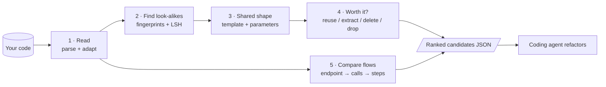
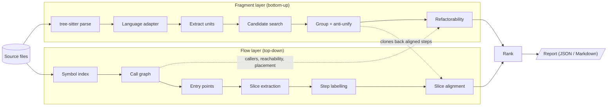
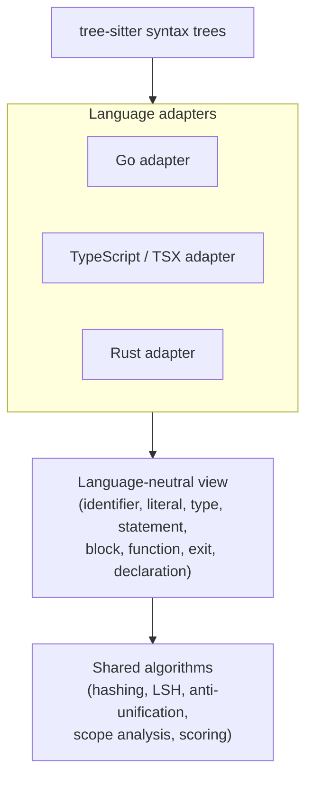
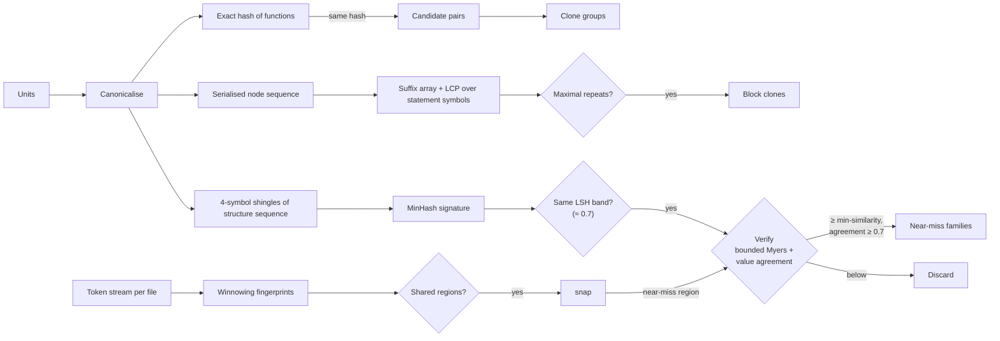
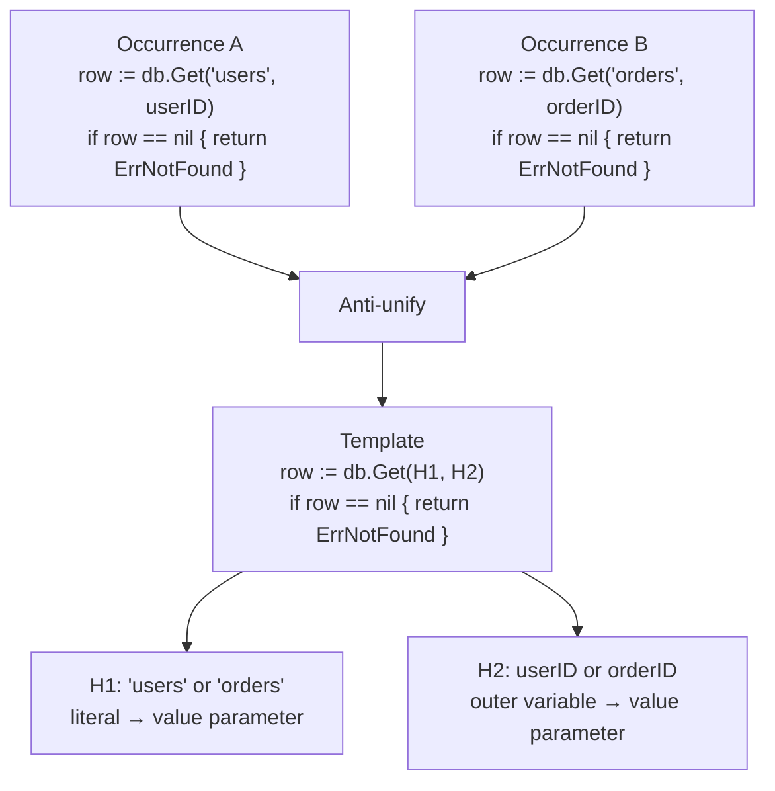
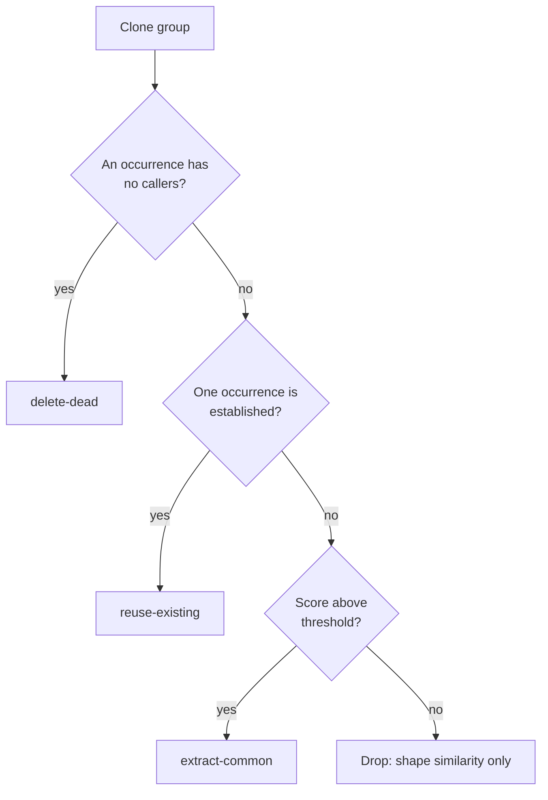
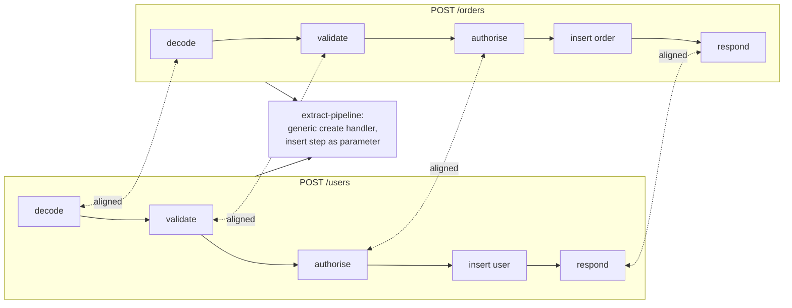
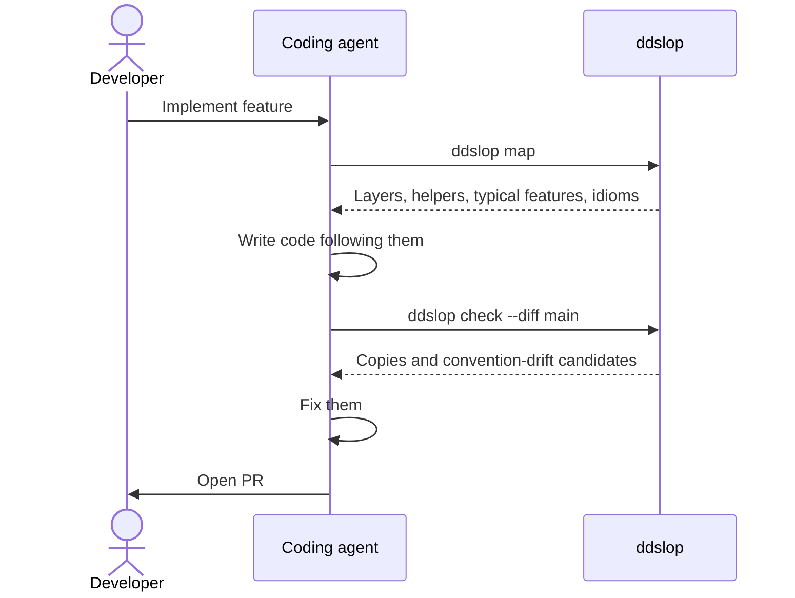
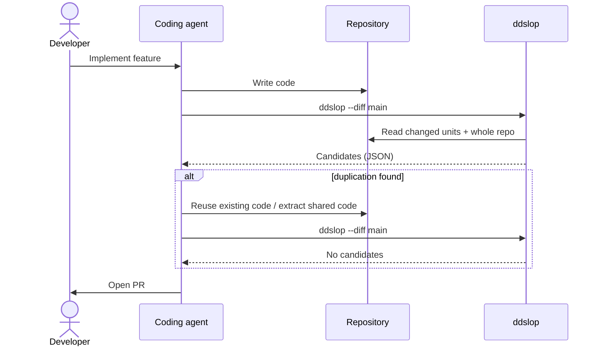
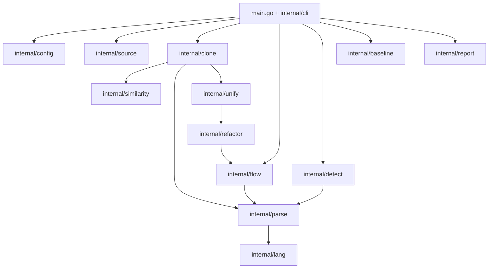

# ddslop architecture

ddslop finds duplicated code in Go, TypeScript and Rust codebases and proposes
refactoring candidates. It is aimed at "de-slopping" AI-generated code, and
its output is meant to be consumed by coding agents (Claude Code, Codex), not
primarily by humans.

ddslop never rewrites source files. It produces precise, self-contained
candidates; the agent decides and performs the refactoring.

## Goals and non-goals

Goals:

- Find duplication that AI agents typically produce, including code that was
  regenerated rather than copy-pasted.
- Turn raw similarity into actionable refactoring candidates: what to extract
  or reuse, with which parameters, and where to put it.
- Find duplicated *flows* (for example, every endpoint re-implementing the same
  decode, validate, query, respond pipeline), not only duplicated fragments.
- Be fast enough to run on every agent change (diff mode).
- Show agents the conventions a codebase already has (its layers, shared
  helpers and typical features) before they write code, so they do not
  reinvent them (`ddslop map`, planned; see Map layer).

Non-goals:

- Applying refactorings automatically.
- Deciding semantic equivalence with certainty. The tool proposes; the agent
  judges.
- Cross-language duplication (for example, a TypeScript frontend and a Go
  backend sharing validation logic). Each language is analysed on its own.

## How AI code gets duplicated

Humans copy-paste, so human clones are close to identical. Agents regenerate
code, so their duplication is structurally similar but rarely token-identical.
The patterns ddslop targets:

| Pattern | Example | Clone type |
| --- | --- | --- |
| Reinvented helper | new `formatUserName()` next to existing `formatName()` | 3–4 |
| Parallel siblings | `handleCreateUser` vs `handleCreateOrder` | 2–3 |
| Duplicated pipelines | every endpoint re-implements decode → validate → query → respond | flow-level |
| Duplicated types | `UserDTO`, `UserResponse`, `UserData` with the same fields | structural |
| Scattered constants | the same timeout or URL literal in many files | literal |
| Reinvented stdlib | hand-written `contains`, `min`, `chunk`, `retry` | 3–4 |
| Stale versions | `parseConfig` and `parseConfigV2` both present, one unused | 2–3 |

The clone types in the last column are explained in the next section.

## Clone types

Clone research sorts duplicated code into four numbered types, from "exact
copy" to "same behaviour, different code". Each type is harder to detect
than the one before, and needs a different refactoring. ddslop also uses
three extra categories for duplication that is not about function bodies.

All examples below are variations of this Go function:

```go
func sumPositive(nums []int) int {
	total := 0
	for _, n := range nums {
		if n > 0 {
			total += n
		}
	}
	return total
}
```

### Type 1: exact copy

The code is identical except for whitespace, formatting and comments.

```go
func sumPositive(nums []int) int {
	total := 0 // running sum
	for _, n := range nums {
		if n > 0 { total += n }
	}
	return total
}
```

- **Typical cause:** plain copy-paste. Rare in AI code, because agents
  regenerate rather than copy.
- **Detection:** hash the syntax tree; formatting and comments are not part
  of it. Cheap and exact.
- **Refactoring:** delete one copy and call the other (`reuse-existing`).

### Type 2: renamed or parameterised copy

Same structure, but identifiers, literals or types differ.

```go
func sumLarge(amounts []int) int {
	sum := 0
	for _, a := range amounts {
		if a > 100 {
			sum += a
		}
	}
	return sum
}
```

Two kinds of difference matter here:

- **Consistent renaming** (`total` → `sum`, `n` → `a` everywhere). These are
  local naming choices and do not need parameters.
- **Changed literals, types or outer names** (`0` → `100`). These change
  behaviour and become parameters: `sumAbove(nums []int, min int) int`.

- **Typical cause:** parallel siblings such as `handleCreateUser` and
  `handleCreateOrder`, or one agent session adapting another's code.
- **Detection:** hash the syntax tree with identifiers and literals replaced
  by placeholders. Still cheap and exact.
- **Refactoring:** `extract-common` with the changed values as parameters,
  or `reuse-existing` if one copy already takes them as parameters.

### Type 3: near-miss copy

Mostly the same, but statements were added, removed or changed. Usually
combined with type 2 renaming.

```go
func sumPositive(nums []int) int {
	total := 0
	for _, n := range nums {
		if n > 0 {
			log.Printf("adding %d", n)
			total += n
		}
	}
	return total
}
```

- **Typical cause:** the most common AI pattern. An agent rewrites a helper
  from scratch and adds its own logging, checks or error handling.
- **Detection:** hashes no longer match. ddslop compares vectors of node-kind
  counts with LSH to find near matches, then confirms them with tree edit
  distance and a similarity threshold.
- **Refactoring:** harder. The extra statements become optional behaviour (a
  function parameter or an option), or the agent decides the extra statement
  was unnecessary and drops it.

### Type 4: same behaviour, different code

The code does the same thing but is written differently: other control
flow, other library calls, a different algorithm.

```go
func sumPositive(nums []int) int {
	total := 0
	for i := 0; i < len(nums); i++ {
		total += max(nums[i], 0)
	}
	return total
}
```

- **Typical cause:** an agent reinventing a helper it did not know existed,
  or reimplementing standard library functions.
- **Detection:** syntax comparison mostly fails. Partly covered by the
  stdlib catalogue and the flow layer; code embeddings are planned for later.
  Proving true equivalence is undecidable in general, so ddslop only flags
  likely cases and leaves the judgement to the agent.
- **Refactoring:** usually `reuse-existing`: keep the better version.

### Other categories

| Category | What is duplicated | Example | Detected by |
| --- | --- | --- | --- |
| Flow-level | a sequence of steps across several functions | every endpoint does decode → validate → query → respond | flow layer |
| Structural | type declarations | `UserDTO` and `UserResponse` with the same fields | duplicate type detector |
| Literal | constant values | the same constant declared in two services, or a constant's value written out again | constant detectors |
| Simplification | not a copy, but code to remove or flatten | an unused public helper, a wrapper that only forwards, a trait with one implementation | simplification detectors |

### Summary

| Type | What differs | Detection method | Cost | Planned for |
| --- | --- | --- | --- | --- |
| 1 | formatting, comments | syntax tree hash | low | v1 |
| 2 | names, literals, types | normalised syntax tree hash | low | v1 |
| 3 | added, removed or changed statements | LSH + tree edit distance | medium | v1 |
| 4 | the implementation itself | stdlib catalogue, flow layer, embeddings | high | v2 and later |
| Flow-level | which functions, same steps | call graph + slice alignment | high | Go prototype, then v2 |
| Structural | type names | field-name sets | low | built (Rust) |
| Literal | location only | constant and literal index | low | built (Rust) |

## How it works

A run of ddslop goes through five steps:

1. **Read the code.** Every Go, TypeScript and Rust file is parsed into a
   syntax tree. A small adapter per language translates the tree into a
   common vocabulary (identifier, literal, statement, function, ...), so the
   rest of the tool does not care about the language.
2. **Find look-alikes.** Functions and runs of statements are fingerprinted
   with names and values blanked out. Identical fingerprints are exact or
   renamed copies; similar fingerprints (via LSH) are near-copies that are
   then verified properly.
3. **Work out the shared shape.** For each group of look-alikes, ddslop
   lines up the copies and keeps what they have in common as a template. The
   places where they differ become the parameters of a shared function.
4. **Check it is worth it.** It checks what the copies read and write, whether
   they `return` or `break` out early, and where shared code could live. Then
   it decides: reuse an existing copy, extract a new function, delete a dead
   copy, or drop the match as mere shape similarity.
5. **Look at whole flows.** Separately, it starts at each endpoint, follows
   the calls, and compares the resulting paths. Endpoints that walk through
   the same steps point to a missing middleware or generic handler.

Everything ends up as a ranked list of candidates in JSON, with exact file
locations, what differs, and what to do. A coding agent reads the list and
performs the refactoring.



## Overview

ddslop works in two complementary layers:

- **Fragment layer (bottom-up):** finds similar functions and statement
  sequences, and works out how they could be unified.
- **Flow layer (top-down):** starts from entry points (for example HTTP
  endpoints), follows the call graph to build execution slices, and aligns
  slices to find duplicated pipelines.

Fragment matches feed the flow layer: an aligned step between two slices is
usually backed by a fragment clone. A third layer, the map layer
(planned), summarises what the other two know about the codebase as a
whole, so agents can follow its conventions before writing code.



## Fragment layer

### Parsing and language adapters

As built: `internal/lang/syntax` flattens tree-sitter trees for every
language (structure sequence, blanked leaves, blocks of statements, early
returns), and each adapter describes its grammar to it: which node kinds
are names, types and literals, which positions declare names, which node
holds a block's statements, and per-node hooks. Each language prefixes
its node kinds before they become symbols (Rust with nothing, so its
fingerprints predate other languages; Go with `go:`), so alike-named kinds
(identifier, block) never make a Go function a near miss of a Rust one.
Files are indexed by extension (`.rs`, `.go`), and each candidate's
`language` is its first file's. The Go adapter (`internal/lang/golang`)
extracts functions and methods (named `Type.Method`, the receiver
without pointer or type arguments); function literals stay part of their
function; `_test.go` files and `testdata/` directories are test code; the
generated-file header rule (`// Code generated ... DO NOT EDIT.`) is
shared. Go's package-level structs and constants feed the same detectors
as Rust's: a multi-name field (`ID, Name string`) or constant
(`a, b = "x", "y"`) gives one entry per name, an embedded field is named
after its type as Go names it, and `iota` or implicit constant values have
nothing to compare; the package directory plays the crate's part for
inlined constants. Go calls are recorded too: `f(x)` is a free call, a
selector on the method's receiver (`s.load(x)`) a call on self, one on an
imported package name (`json.Marshal`, aliases and `/vN` suffixes
understood) a path call, and any other selector a method call. The call
graph splits Go names at the dot (`Store.Load`), resolves a package call
to the workspace package of that name, and never guesses for an outside
package. Pass-through wrappers work the same way as in Rust; Go methods
are left out, since they may satisfy an interface. The rule "the
arguments are the parameters, in order, as is or borrowed" lives once in
`syntax.PassesOn`; the per-grammar rest of wrapper detection and of the
grammar hooks stays per adapter until a third language (extract on the
third occurrence), recorded in ddslop's own baseline. Go functions also
record their parameters (a `context.Context` left out: Go passes it
explicitly and never stores it in a struct, so it is never part of a
parameter object) and their switches on strings (`case "a", "b":`), so
parameter groups and string kinds work for Go; methods are left out of
parameter groups, as they may implement an interface whose signature they
must keep. On a 100-file Go service, every raw group hinged on a Context
or an HTTP handler's dictated signature, so none remain.

Feature flows work for Go too. A generated file's interfaces give the
entry points: Go implements interfaces implicitly, so a method named like
one of a generated interface's methods (an OpenAPI server's
`GetDocument`) is an entry point, where a Rust impl names its trait. Like
Rust's list of standard-library method names, `goStdMethods` keeps Go
calls such as `w.Header()` on an `http.ResponseWriter` from being pinned
on the code's one `Header` method; on the Go service that dropped 72 of
795 name-resolved calls that had pointed at the wrong function. That
service has 37 entry points and no parallel flows: its handlers are thin
and delegate to different services.

Setup-teardown is not built for Go: `defer x.Close()` is Go's own idiom
for it (18 times in that service, 2 in ddslop), and transactions, the
case a closure helper would serve, appear two or three times per
codebase, below the five functions the detector asks for.
On a 100-file Go service: 43 candidates and 12.2% duplication, led by an
authentication check in 14 handlers; with declarations, a client package
re-declaring the server's response types (`MemoryItem`, `SearchResponse`,
...) was the main new finding.

All three languages are parsed with tree-sitter
(`github.com/tree-sitter/go-tree-sitter` plus the Go, TypeScript/TSX and Rust
grammars). This requires cgo.

Algorithms are written once against a language-neutral view. Each language
provides a thin adapter that maps tree-sitter node kinds to roles:

- identifier, literal, type reference
- statement, block, function/method, closure
- control-flow exits: `return`, `break`, `continue`, `?` (Rust), `throw`
- variable declaration and assignment (for scope analysis)
- nodes to ignore (comments, attributes, decorators as configured)

Adding a language means writing an adapter, not new algorithms.



### Units of comparison

- Whole functions and methods.
- Contiguous statement sequences inside blocks (block clones), found as
  maximal repeats by the suffix array (see Candidate search) rather than by
  fixed sliding windows, so each copied region is reported once at its full
  length. Most copy-paste lives here, not at whole function level.
- Type declarations (structs, interfaces, type aliases), handled by a separate
  detector (see below).

### Candidate search

Comparing every pair of units is quadratic, so candidates are found by
hashing. Because agents regenerate rather than copy, fuzzy (type 3) matching
is part of the first version, not an extension. Candidate search has five
stages:

1. **Canonicalisation.** Before hashing, each adapter rewrites equivalent
   forms into one canonical form: `i++` and `i += 1`, operand order of
   commutative operators, inverted `if`/early-return, range and index loops
   where safe. Many near copies become exact copies here, and fall into the
   cheap path.
2. **Exact hashing of whole units (types 1–2).** Hash each function's
   canonical syntax tree with identifiers and literals replaced by
   placeholders. Functions sharing a hash are candidate clones. Linear in code
   size.
3. **Maximal repeats of statements with a suffix array (types 1–2,
   block clones).** Borrowed from `dupl`, but over statements rather than
   node kinds. Each statement of every block becomes one symbol identifying
   its structure (the hash of its structure sequence), each block a run of
   such symbols ended by a unique separator. A suffix array plus LCP array
   over the concatenation yields every maximal repeated run in O(n log n),
   at any length and without overlapping windows. Because the symbols are
   whole statements and separators are unique, repeats consist of complete
   statements and never cross blocks, so exact repeats need no snapping,
   and the sequence is about a hundred thousand statements rather than
   millions of symbols. `dupl` uses a suffix tree; a suffix array gives the
   same repeats at a fraction of the memory. Go's `index/suffixarray` does
   not expose the array or LCP, so ddslop builds its own (prefix doubling
   plus Kasai's LCP algorithm).

   Repeats are then filtered: overlapping occurrences in one block are
   dropped; a run is skipped when its occurrences sit in distinct functions
   already reported together (a function clone group, or a near-miss family
   including its members' exact and renamed copies), or when at least half
   of every occurrence lies inside block clones kept before it (larger
   ones come first), so a nested block of a copied run, or a guard copied
   in twenty places that ten of them extend by one statement, is not
   reported again. A long run merely containing a reported one is still
   new. A run repeated inside one function is always reported. Only names
   declared inside the run count as local renames; names declared outside
   it, even in the same function, become parameters of the extracted
   helper. Extracting a helper costs more than calling an existing
   function, so block clones need `--min-block-nodes` (default 100, never
   below `--min-nodes`): on a 735k-line Rust codebase, block clones from 100
   nodes up were clearly worth fixing, while most smaller ones were 3-5
   line repeats. A smaller block is still reported when it is copied often:
   at least 25 nodes and 3 lines, and its copies duplicate 400 nodes or
   more in all (as much as a 100-node block in five places). There these
   were shared code worth a helper, such as a 46-node connection guard in
   27 methods; below 400 they were mostly two or three copies of ordinary
   statements. The line minimum came from a second, 188k-line codebase,
   where two-line idioms (clone a handle and open a transaction, 47 times)
   ranked first: on both, every frequent block of one or two lines was an
   idiom a helper call would not shorten (14 in all), and every one from
   three lines on was a guard or lookup worth extracting.
4. **MinHash + LSH over structure-sequence shingles (type 3).** Each unit's
   syntax tree is flattened in pre-order into a structure sequence: a symbol
   per node kind, a close symbol after each node's children, and a symbol
   per blanked-out leaf kind. Edit distance on such a bracketed sequence
   closely tracks tree edit distance and is far simpler to compute. Each
   unit is broken into shingles of 4 consecutive symbols; a MinHash
   signature (128 hashes, computed while indexing) estimates the Jaccard
   similarity of two units' shingle sets, and LSH banding (16 bands × 8
   rows, threshold ≈ 0.7) only proposes units likely to be similar. Shingles
   of 4 rather than 8 symbols keep a pair with one inserted statement well
   above the threshold. This replaces both pq-grams and DECKARD-style
   node-count vectors, which ignore order.
5. **Winnowing (near-miss partial matches).** MinHash compares whole units,
   and the suffix array only finds exact repeats, but agents often embed a
   slightly modified copied block inside a larger, unrelated function.
   Winnowing (the MOSS algorithm) keeps a guaranteed-representative sample of
   token fingerprints per file. Matching fingerprints locate shared regions
   regardless of the surrounding code; those regions become statement-run
   candidates.

**Snapping to syntax units.** Also borrowed from `dupl`. A shared region
from stage 5 rarely starts and ends on statement boundaries (stage 3
repeats always do, since their symbols are whole statements). Each region
is trimmed to the largest sequence of *complete*
sibling statements (or a whole function) it covers; whatever is left after
trimming is discarded if it falls below the minimum size. Without this step,
ddslop would suggest extracting half an `if` block.

**Size in syntax nodes, not lines.** Every size threshold is measured in
syntax tree nodes (`--min-nodes`), which formatting cannot change; line
counts are used only for display and for the "lines saved" part of the
score. This is how `dupl` measures size too.

What ddslop deliberately does *not* copy from `dupl`: it ignores identifier
and literal values completely, so two blocks with the same shape but
unrelated meaning match. ddslop also normalises values for matching, but
anti-unification and scoring then look at the actual values, and candidates
whose differences are too many to be parameters are dropped.

Every candidate pair is then **verified**, in parallel, run only on the
pairs LSH proposes:

- **Similarity** is `2·LCS/(len(a) + len(b))` of the two structure
  sequences, computed with Myers' diff algorithm bounded by the threshold,
  so dissimilar pairs stop early. Pairs whose lengths alone rule out the
  threshold are rejected without aligning. `--min-similarity` (default
  0.8) sets the threshold.
- **Value-anchored alignment.** Code often repeats one statement structure,
  so many alignments are equally long and a structural one may pair the
  wrong statements. The matches are therefore anchored on equal names and
  values (in order); between anchors, the tail of the previous anchor's
  line and the head of the next anchor's line are matched first, and the
  rest is aligned on structure, which pairs renamed and changed values.
- **Value agreement.** The share of aligned names and values that are equal
  or consistent local renames must be at least 0.7. Measured on a
  735k-line Rust codebase, pairs from 0.7 up were real copies, while pairs
  below 0.4 were unrelated code sharing common Rust structure (match tables,
  `Default` and `Display` impls). Without this filter, structure alone
  reported thousands of such pairs.

The alignment gives the differences (values at aligned positions) and the
unmatched lines (code without a counterpart), which is what anti-unification
needs next.

**Near-miss families.** Verified pairs are clustered: the function with
the most near-miss edges anchors its neighbours, so every member is a
verified near miss of its anchor, and leftovers pair with their heaviest
neighbour. One shape is represented by one function, so a group of exact
copies takes part once. A family is reported as one candidate. On the same
codebase this turned 3,883 near-miss pairs into 504 candidates.

**Size floor for near misses.** Small functions often share Rust's usual
shape (a `match` writing messages, a one-line delegation) without being
copies, and the agreement filter cannot tell them apart. A hand audit on
a large Rust codebase of 5 random near misses found 3 false and 1 trivial
one, all with 61-119 nodes, while every real near miss checked had 220
nodes or more. Near misses therefore need `--min-near-nodes` (default 150,
never below `--min-nodes`). A fresh audit of 8 random near misses after
the change found 5 worth fixing, 3 marginal and none false; near-miss
families on that codebase dropped from 502 to 208.

Partial-region verification (Smith-Waterman for winnowing regions) comes
with winnowing.

File-level fuzzy hashes such as ssdeep or TLSH are deliberately not used:
they work on raw bytes, which is too coarse and too sensitive to formatting
for source code.



### Grouping and anti-unification

Verified pairs are clustered into clone groups of N occurrences. For each
group, ddslop computes the **anti-unifier**: the most specific syntax tree
template shared by all occurrences, with *holes* where they differ.

- The template is the body of the proposed shared function.
- The holes become the `differences` in the output and, after
  classification, the parameters.



Hole classification:

| Hole | Meaning | Becomes |
| --- | --- | --- |
| Identifier renamed consistently within each occurrence | local naming difference | nothing (local variable) |
| Literal or expression | varying value | value parameter |
| Type | varying type | generic type parameter |
| Call or statement | varying behaviour | function parameter (higher cost) |

### Refactorability analysis

Similarity alone is not enough; ddslop checks whether a group can actually be
unified:

- **Inputs and outputs.** Variables read but defined outside the fragment
  become inputs. Variables written inside and used after it become outputs:
  multiple return values in Go, a tuple in Rust, an object in TypeScript.
- **Control-flow escapes.** `return`, `break`, `continue`, `?` or `throw`
  leaving the fragment make extraction harder. The candidate is penalised or
  the suggestion includes a status-return pattern.
- **Receivers and methods.** Occurrences on different receiver types suggest
  an interface (Go), trait (Rust) or generic (TypeScript).
- **Placement.** The shared code goes in the nearest package or module
  visible to every occurrence; Rust crate boundaries and visibility are
  checked.

### Suggestion kinds



"Established" means older, more callers, or outside the diff.

- `reuse-existing`: one occurrence is the established version (older, more
  callers, outside the diff). Replace the others with calls to it. This is
  the most common and cheapest fix for AI duplication.
- `extract-common`: no occurrence is canonical. Extract a new shared function
  from the template.
- `delete-dead`: a public function nothing uses (see below). Delete it.
- `extract-pipeline`: produced by the flow layer (see below).
- `inline-wrapper`: a function that only forwards its parameters; call
  its target directly.
- `remove-trait`: a trait with one implementation; make its methods the
  type's own.

As built, `reuse-existing` and `extract-common` follow from the
differences (a candidate with parameters is `extract-common`), and the
other actions belong to one candidate kind each.

### Scoring

Each candidate is scored as lines saved times occurrences, minus a cost per
parameter, function parameter and control-flow complication. Candidates
needing many parameters to save few lines are shape similarity rather than
duplication, and are dropped below a threshold.

### Noise filtering

- Generated code. A file is generated when its leading comment block (the
  comments before the first line of code) contains `@generated` or "do not
  edit", or a comment starting with "Generated by" or "Code generated".
  Only the header counts, so a generator's own source, which mentions these
  phrases in templates, is still analysed. Skipped files are counted in the
  summary (`generated_files`). Configured paths come later.
- Known idioms per language (for example Go's `if err != nil { return err }`).
- Fragments below a minimum size, measured in syntax nodes (`--min-nodes`).
- Candidates that would be mostly parameters: fewer than 20 nodes per
  parameter. Extracting them would turn most of the body into arguments;
  the copies share a shape, not logic. On a large Rust codebase every
  audited real target had 24 or more nodes per parameter, while `Debug` and
  `Display` impls, match tables mapping variants to different strings, and
  same-shaped one-line delegations had 12.7-19.8. The rule dropped 41
  candidates there and kept all 12 audited real targets.
- Test code is skipped by default and counted in the summary (`test_units`);
  `--tests` includes it. In Rust, test code is a function with a test
  attribute (`#[test]`, `#[tokio::test]`, `#[rstest]`, `#[test_case]`), a
  function in a `#[cfg(test)]` module, a function in a `tests/` or
  `benches/` directory or a `tests.rs` module, or a function in the file
  of an out-of-line test module declared in its parent
  (`#[cfg(test)] mod real_ledger;`) and in that module's submodules.
  a large Rust codebase has 124 such declarations. Analysing tests separately with
  looser thresholds comes later, since table-driven tests are intentionally
  repetitive.

### Additional detectors

These work on declarations other than functions, which the Rust adapter
collects in the same pass as the units: structs with named fields,
module-level `const` and `static` items, trait declarations, trait impls
and the names of all declared types. Each was measured on a 735k-line
Rust codebase before it was built.

- **Duplicate types** (`duplicate-type`): structs declaring the same field
  names, in any order, with three fields or more. Field types that differ
  are listed as differences, so the usual parameter rule applies: a pair
  that differs in most of its types is dropped as shape similarity. Two
  fields matched mostly by coincidence (host and port); from three fields
  on, 31 candidates remained, mostly one type copied into several
  services, or a wire type mirroring a domain type. A second, 188k-line
  codebase refined the rule: three-field structs must match in the types
  of fields holding scalars or strings (`{id, name, count}` with `i64`
  and `usize` was a coincidence, a timestamp held as a `String` a view),
  while a field of the code's own types may differ (`Receipt { operation,
  operation_id, result }` around different results is one generic
  struct), and a
  struct another one names in `#[serde(try_from = "...")]`, `from` or
  `into` is left out, since validating an authored form into a checked
  type is a deliberate second type.
- **Duplicate enums** (also `duplicate-type`): enums declaring the same
  variants, names and payloads, in any order. Measured on both codebases:
  three or more shared variants, or two with payloads, were one type
  declared again (a sandbox state and a run status with the same seven
  states; one error enum per module with the same failures, such as
  `Environment` in four places); two bare variants (`Bind`, `Volume`)
  were coincidences unless the enums also shared their name. 4 and 29
  groups.
- **Duplicate constants** (`duplicate-constant`): constants declared with
  the same name and value. The same value alone is no evidence (64 and
  1000 are everywhere); the same name too means a copy. Macro values
  (`include_str!("x")` means a different file per crate) and `const _`
  assertions are left out. 63 candidates, such as a size limit declared
  in two services.
- **Inlined constants** (`inlined-constant`): a string literal repeating
  the value of a string constant of the same crate, with the constant as
  the candidate's `target`. Repeated literals in general were noise (JSON
  keys, Redis commands); a literal matching a named constant is the
  constant's meaning written out again. Short plain words (`"status"`,
  `"model"`) still matched unrelated keys, so a value needs 10 characters
  or anything besides letters, digits and underscores, and at least one
  letter: `"*"`, `"/"` and `"1.5"` mean something different wherever they
  are written. 41 candidates, such as a Redis field name the code writes
  out 25 times next to its constant.
- **Stdlib reinvention** (planned): a small, curated catalogue of patterns
  per language (for example, a loop returning true on match →
  `slices.Contains`).

### Simplification detectors

`internal/simplify` reports code that is not a copy but can be removed or
flattened, the other half of cleaning up generated code:

- **Dead code** (`dead-code`, `delete-dead`): a public function whose name
  appears nowhere but in its own declaration. Every identifier-like word of
  every source file is counted, comments, strings, macros, generated and
  test files included, so a name mentioned anywhere (a call, a `use`, a
  `#[serde(default = "f")]`, a doc link) counts as used; this is
  conservative and needs no name resolution. The compiler already reports
  private functions, and it found none there; what it cannot see is a
  public function of a workspace library, so only those are reported, and
  only in crates that are not published (`publish = false`, directly or
  through `publish.workspace = true`): a published crate's public items
  are its API. Trait methods and functions with attributes that may call
  them from outside (`#[no_mangle]`, `#[tokio::main]`, route macros; lint,
  inline, doc, cfg and tracing attributes do not count) are left out. 6
  candidates, each verified with grep. In Go, public means exported, and
  a package serves only the analysed code when it sits under an
  `internal` directory (which the go tool forbids importing from outside)
  or is `package main`. Go methods are left out like trait methods, since
  any method may satisfy an interface without its name being written
  (`ServeHTTP`, `Error`); the unit model calls both "via interface". `main`
  and `init` are called by the runtime. On a 100-file Go service, the one
  exported function nobody mentioned was in a generated file, so none.
- **Pass-through wrappers** (`pass-through`, `inline-wrapper`): a function
  whose body is one call, possibly awaited, passing its parameters on in
  order, as is or borrowed. Constructors (`Self(x)`), delegation to a field
  (`self.inner.get(x)`) and trait methods are not wrappers. The callee is
  resolved through the call graph and becomes the `target`; a wrapper
  around a library function (`serde_json::to_string`) gives it a domain
  name and is left out, and so is a call the graph resolves back to the
  wrapper itself (`super::f` from `f`). 15 candidates. Wrappers that fix a
  generic type parameter of their target are deliberate; the skill tells
  agents to keep them.
- **Single-implementation traits** (`single-impl-trait`, `remove-trait`):
  a trait declared once and implemented once, for a type the code declares
  itself. Left out: traits a test double also implements (the reason the
  trait exists), extension traits on foreign types, blanket impls, and
  public traits of published crates. 3 of 71 traits.

A further idea, generic parameters only ever instantiated with one type,
needs type inference and is not planned.

### Pattern proposals

Some repeated code is a missing idiom rather than a missing helper. A
pattern detector is a fixed rule over evidence ddslop already has
(copied blocks and their positions, the call graph, declarations); a
match names the idiom in `suggestion.pattern`, the Rust form first, and
its Gang of Four counterpart in `suggestion.gof`. No model is involved:
the same code always gives the same proposal, and the agent judges
whether it fits. Pattern proposals are `check`'s side of the map's
concerns (see Map layer, Concerns): the map describes the same evidence,
and its fallback idiom for a concern is the proposal's pattern.

- **Shared preamble** (`shared-preamble`, `extract-preamble`, pattern
  `extractor`, GoF Chain of Responsibility): a copied block that holds
  the first early return (a `return` or a `let ... else`) of at least 5
  functions, with statements after it. Setup before it is allowed
  (tracing, a page title, parsing the query), so a sign-in check after two
  to five such statements still counts. A block clone that is a preamble
  is reported as one, not twice. Measured on both codebases: openings
  that return early were sign-in, credential, permission and readiness
  checks (7 candidates, all real), while openings whose only exit was a
  `?` were setup (acquire a lease, run a query), and those without an
  exit were matches, view templates and closures. A whole function body
  is a copied function, not a preamble.

- **Setup and teardown** (`setup-teardown`, `extract-scope`, pattern
  `closure-helper`, GoF Template Method): at least 5 functions that bind a
  value from a call in one of their first three statements and, in one of
  their last three, call a closing method on it (`commit`, `rollback`,
  `close`, `release`, `finish`, `shutdown`, `abort`) or drop it, grouped
  by the producing call and the closing method. A looser rule (any value
  used again at the end) matched vectors filled in a loop and hashers;
  requiring a closing method left only scopes: a transaction begun and
  committed in 57 functions of the 188k-line codebase, and on the 735k-line
  one a pool lease acquired and released in 15 and a transaction in 6.

- **Strings used as kinds** (`string-kinds`, `introduce-enum`, pattern
  `enum`; no GoF counterpart, Fowler's "replace type code"): matches with
  at least 3 string literals among their arm patterns (guards are not
  patterns), grouped by their set of literals, kept when 3 or more
  functions match the same set. Sets matched in two functions were mostly
  a parser and its inverse or external values (HTTP statuses, MIME types,
  API paths); from three on they were outcomes and states passed around as
  strings: an answer's "committed", "refused", "replayed" interpreted in
  seven functions, refund outcomes in four. One set already had an enum
  that two functions parsed the strings into separately; the skill tells
  agents to reuse an existing enum.

- **Parameter groups** (`parameter-group`, `introduce-parameter-object`,
  pattern `parameter-object`; Fowler's "introduce parameter object"): the
  same parameters, names and types, taken by at least 4 functions, at
  least 3 of them. Trait methods are left out, since the trait dictates
  their parameters. For each set of functions sharing 3 parameters, the
  group is everything they share, so no group repeats inside a larger one
  taken by the same functions; then groups sharing 2 parameters are one
  concept, represented by the largest (an ingest context taken as four
  overlapping groups of three or four of its fields). The candidate lists
  the parameters in `values`. Measured: 32 and 60 raw groups became 15
  and 26, led by an ingest context in 12 functions, a worker context in 9
  and a namespace handle with its database in 15; signatures a framework
  dictates and recursion helpers threading state remain for the agent to
  judge.

Not built, from the same measurement: repeated error conversions as
`impl From`. The repeated `.map_err` calls mostly go through helpers
the code already names (`db`, `unavailable`, `store`), each choosing which
variant to produce; replacing them with `From` is correct only when a
source error type always maps to one variant, which ddslop cannot see
without types.

## Flow layer

### Symbol index and call graph

Tree-sitter gives syntax but not name resolution, so method calls through
interfaces, traits and closures cannot be resolved reliably from syntax
alone. ddslop must still work as a single standalone binary, so the call
graph comes from the best source available, in this order:

1. **SCIP index, if provided** (`--scip index.scip`). SCIP gives definitions
   and references in one format for all three languages. ddslop only *reads*
   an index; it never runs an indexer. Projects that want precise flows add
   one CI step before ddslop:
   - Go: `scip-go`
   - TypeScript: `scip-typescript`
   - Rust: `rust-analyzer scip`
2. **Go: `golang.org/x/tools` in-process.** `go/packages` plus the VTA call
   graph gives precise results without an external indexer. It needs the Go
   toolchain on `PATH` (it runs `go list`), which any CI building a Go
   project already has. If loading fails, ddslop falls back to step 3.
3. **Name-based approximation from tree-sitter** for everything else.

As built for Rust (name-based; no SCIP or rust-analyzer yet): the adapter
records each function's calls (free `foo()`, path `Type::foo()`, method
`x.foo()`, with `self` receivers marked) and, for trait impls, the trait.
Resolution is conservative: an ambiguous call stays unresolved rather
than linking to every candidate, because a wrong edge pollutes every slice
that crosses it.

- A bare call `foo()` to a name the caller declares itself (a closure or
  function value, `let unsigned = |v| ...`) is not a function call.
  Otherwise it prefers the caller's file, then a unique function in its
  crate. It leaves the crate only through a `use` import, and only into a
  workspace crate (aliases followed); an import from an outside crate
  such as `tokio` is never resolved to a repository function.
- `Type::f` matches methods of `Type` (generics ignored), `Self::f` the
  caller's type. Other paths fall back to free functions only when the
  qualifier is a module (lower case), so `Utc::now()` does not resolve to
  a repository function named `now`; a module path naming a workspace
  crate (`acme_token_credentials::is_canonical_key_id`) resolves into that
  crate, any other into the caller's own.
- `self.m()` resolves to the caller's type. `x.m()` resolves only when one
  method of that name exists, and never for common standard-library method
  names (`as_ref`, `len`, `push`, `find`, `collect`, ...): on
  a large Rust codebase, resolving those by uniqueness put `ModelId::as_ref`
  into 80 feature slices.
- Outside its own crate, a call resolves only into workspace crates the
  caller's crate imports from in its code, not in its tests: a crate used
  only as a dev-dependency is not a dependency.
- Crates are named as code names them, from `Cargo.toml` (`[lib] name`,
  else `[package] name`, dashes as underscores), not after their
  directory: `crates/token-credentials` is `acme_token_credentials`.
- Calls inside macros are not visible.

On a large Rust codebase these rules left 13 distinct cross-crate links
in feature slices, all into crates the services really use
(`token-credentials`, `traces`, the translation crates). Before them,
about half of 134 cross-crate links were wrong.

On a large Rust codebase, 84% of free calls to repository functions
resolve; most unresolved method and path calls are standard-library calls
whose names the repository also defines.

### Entry points

Entry points are found by small per-framework detectors that recognise route
registration:

- Go: `net/http`, chi, gin
- Rust: axum, actix-web
- TypeScript: express, NestJS, Next.js route handlers

Also supported: explicit entry points (`--entry pkg.Func`), and a generic
fallback (exported functions with no callers).

As built: entry points are methods implementing a trait declared in a
generated file, which covers OpenAPI-generated server traits (the index
keeps each file's declared traits, including generated files'). On
a large Rust codebase that finds 189 entry points, including the 81
operations of its development mock ledger. `ddslop flows` lists each entry
point and its slice (breadth first, `--depth`, default 6; test code is left
out), as text or JSON.

### Slice extraction

A slice is the call tree reachable from one entry point. To keep slices
meaningful:

- Stop at the standard library and third-party dependencies.
- Limit depth.
- Collapse ubiquitous utilities (logging, config access) into leaf nodes.

### Step labelling and alignment

Each step in a slice is labelled with a role such as decode, validate,
authorise, query, transform or respond, using heuristics on names,
signatures and the libraries called. Slices are then aligned (sequence
alignment over steps, tree edit distance over call trees). Steps are weighted
by distinctiveness, TF-IDF style, so steps every slice shares (logging, the
database client) do not make all slices look alike.

Aligned steps backed by fragment clones are strong evidence. A group of
slices sharing most steps produces an `extract-pipeline` candidate:
middleware, a generic handler or a shared service.



Labelling is fuzzy and is where an LLM excels. ddslop extracts and aligns
slices precisely and includes the raw steps in its output, so the consuming
agent can make the final semantic call.

As built, without role labels: two features are compared on their *own*
steps. Steps both reach are reuse, not duplication, and steps reached by
more than a quarter of all features (and more than two) are shared
infrastructure, so neither counts; steps under `--min-nodes` are ignored.
Similar step pairs come from MinHash LSH over the slice functions,
verified with structural similarity of at least 0.7. Each pair of
features matches its own steps greedily, most similar first. A pair with
at least 4 matched steps covering at least a fifth of its own code is
parallel, and parallel pairs are grouped into families with the same star
clustering as near misses. `check` reports each family as a
`parallel-flow` candidate: the entry points as occurrences, `steps` with
the function playing each role in every feature and its similarity to the
anchor's, and an `extract-pipeline` suggestion. Diff mode keeps a flow when
any step changed.

On a large Rust codebase this found 6 families, all real: 11
`Management` write operations sharing a handler -> authorise ->
fingerprint -> read receipt -> build event -> interpret -> refuse pipeline
(17 aligned steps), 7 history and finance listings, the three `OwnerApi`
operations (54% coverage), 4 control updates, and `settle_attempt` with
`submit_late_evidence` (9 steps). A single matched step is already a near
miss, which is why 4 steps are required; coverage stays low even for real
families because each feature also has steps of its own. Feature
comparison adds about 0.35 s to a warm check there.

### Uses of the call graph in the fragment layer

- Ranking: code reachable from many entry points is a higher-value fix.
- `inline-wrapper` targets: the function a wrapper forwards to.
- `delete-dead` suggestions: code unreachable from any entry point (built
  instead as a word count, which needs no resolution; see above).
- Choosing the canonical occurrence for `reuse-existing` (most callers).
- Placement: the deepest module shared by all callers.

## Map layer

Sections 1 and 2 are built (`internal/codemap`, `ddslop map` with text
and JSON output; see As built below), and section 3 in part: the
flagged `parallel-flow` families, as measurement left the other two
rules nothing real to report yet. Section 4 is built for error checks
and error wrapping in Go and Rust; its other concerns, section 5,
Markdown output and `--lang` are planned.

The fragment and flow layers find copies after they are written. Most of
them were written because the agent did not know how the codebase already
does the thing: which helper wraps errors or opens a transaction, which
layer a new endpoint goes through, what an existing endpoint of the same
kind looks like. `ddslop map` answers that before the agent writes: a
compact description of the codebase's conventions, derived from evidence
ddslop already has (the call graph, entry points, `parallel-flow` families
and detector results). Like pattern proposals, it is a fixed set of rules
with no model: the same code always gives the same map, and the agent
judges what applies to its change.

### The command

`ddslop map [path]` prints the map as text, JSON or Markdown. It reads
the index like `check` and never changes source files. Every section is
capped (`--limit`, default 10 entries) so the whole map fits in an
agent's context; on the 735k-line codebase the aim is under 300 lines of
text and under half a second on top of a warm index.

Each language gets a map of its own, as each is analysed on its own
elsewhere: a repository with a Rust service and a Go tool gets a Rust
map and a Go map (`--lang` picks one). The JSON output is a list of
maps, each labelled with its language, even when there is only one. Most of a map is specific to the
codebase rather than the language, since its layers, helpers and features
come from the code itself. What depends on the language comes from its
adapter: what a module is, what counts as an interface, and the idioms in
section 4.

### Sections

In the order they are built; each ships only once measured (below).

1. **Layers.** A module is a Go package or a Rust module directly under
   its crate. Resolved calls outside test code give a module graph,
   weighted by the number of calls. The layers come from the dominant
   direction of the calls, so the calls that break them cannot shape
   them: in each cycle (strongly connected component), an edge is set
   aside only when it is weak next to the other edges on a cycle through
   it (a small fraction of the weakest of them, so the test does not
   depend on the size of the component; the fraction comes from
   measurement), the lighter direction between two modules being the
   simplest case. A
   component that is still cyclic after that has no dominant direction:
   its modules are peers, collapsed into one node that shares a layer,
   rather than ordered by a tie-break the calls do not support. What
   remains is acyclic, and each module's layer is its
   longest-path depth from the graph's sources, the modules no other
   module calls. Entry-point modules are sources, but so are the tops of
   parts no entry point reaches (a background worker, a library-only
   subsystem), so every module gets a layer. The map
   lists the layers with their modules, then the calls that break them:
   - an upward call: a set-aside edge whose caller ends up in a lower
     layer than its callee (edges closer to balanced are never set
     aside: their modules are peers and share a layer instead; with
     overlapping cycles, a set-aside edge can end up going down, and is
     then an ordinary call, not a break);
   - a bypass: an edge that skips a layer, from a module whose calls to
     that target mostly go through a module in between ("3 functions in
     `handlers` call `store` directly; 40 calls go through `service`").
     Longest-path depth keeps `store` below `service` despite the direct
     edge, so the skipped layer stays visible. Only a module otherwise
     reached from the skipped layer alone can be bypassed: one that other
     layers call too (shared types, utilities) is a foundation everyone
     uses, not a layer to go through.
   Only resolved calls count, so the map states the share of calls that
   resolved, and a flat codebase with no layering gets no layers rather
   than invented ones.
2. **Shared helpers.** The functions called from the most other modules
   (callers counted per module, so one busy module does not dominate),
   leaving out entry points, test code and pass-through wrappers (already
   reported by `check`). Each entry gives the name, file and line, the
   first line of the signature, and the modules calling it. This is
   `ddslop similar` turned around: the agent sees what to reuse before
   drafting anything.
3. **Typical features.** Every `parallel-flow` family is a `check`
   candidate, so the map always shows one flagged: the member most
   similar to the others (the medoid of its step similarities) as the
   current shape, its steps with the shared helpers each calls, the other
   members, and extracting the pipeline as the way forward, never as an
   example to copy (see Concerns). The example to follow comes from
   features that already share their pipeline, which is what a family
   looks like once extracted: entry points of one trait or interface that
   call the same shared helper (section 2), such as a generic handler,
   give that helper and the entry point calling it as the example ("to
   add an operation, call `handle_write` as `create_order` does"). Other
   entry points are grouped by the trait or interface that made them
   entry points, with the member reaching the most shared helpers as the
   example. Such a group only gives an example: one generated interface can hold unrelated
   operations (health and sign-in routes next to authenticated ones), so
   its members are not peers for section 5.
4. **Idioms.** For each concern the language adapter knows, which form
   this codebase uses and how consistently: "errors: `fmt.Errorf` with
   `%w` in 92% of wrapped returns; 6 functions return `errors.New`
   strings". Each form is recognised by fixed syntax rules the adapter
   already has the evidence for (calls, `defer`, derives, match arms),
   so no types are needed. The concerns and forms, first set:

   | Concern | Rust forms | Go forms |
   | --- | --- | --- |
   | Error values | error enum (`thiserror`), `anyhow` | sentinel errors, custom error types |
   | Error wrapping | `?` with `From`, `map_err` to a helper | `fmt.Errorf` with `%w`, with `%v`, unwrapped |
   | Error checks | match on the variant, compare the message | `errors.Is` and `errors.As`, `==`, compare the message |
   | Scopes (transactions, leases) | closure helper, RAII guard (rolls back on drop, `commit` at the end), `commit` and `rollback` on each path | closure helper, `defer tx.Rollback()` with `Commit` at the end, `Commit` and `Rollback` on each path |
   | Authentication in handlers | extractor, middleware layer, inline check | middleware `func(http.Handler) http.Handler`, inline check |
   | Kinds and states | `enum` with `FromStr`, strings | typed constants with `iota` and `String()`, strings |
   | Parameter groups | struct | options struct, functional options |

   The forms within one concern are alternatives: a codebase uses one or
   another for the same job. A form is the whole pattern, so a deferred
   `Rollback` with a `Commit` on success is one form, counted once.
   Forms are compared only for the same resource: scopes are grouped by
   the call producing the value (as `setup-teardown` groups them), so a
   closure helper for transactions and a guard for leases are two
   conventions, not one with drift. Practices that work together (a
   sentinel error, wrapped with `%w`, checked with `errors.Is`) belong
   to separate concerns, so following all of them is never a deviation; a form that
   turns out to combine with another in measurement moves to its own
   concern. A form is the convention when most occurrences of the
   concern use it (the share comes from measurement). The codebase's convention wins
   even when it is not the textbook idiom, because consistency is what
   prevents the next copy, unless that form is itself repeated code (see
   Concerns). Where a concern has no convention (too few occurrences, no
   form in the majority, or a majority form that is duplicated), the map
   says so and names the idiomatic form: the pattern proposal's
   (`suggestion.pattern`) for a concern that has one, which gain Go forms
   (middleware for `extractor`, `defer` for `closure-helper`, typed
   constants for `enum`) and later TypeScript ones; otherwise, as for the
   error concerns, the form the adapter marks idiomatic in its table of
   forms. ddslop never guesses one.
5. **Deviations.** A `check` candidate, `convention-drift` with suggestion
   `follow-convention`, for code that breaks a convention most of its
   peers follow: the bypasses from section 1, entry points of one
   `parallel-flow` family (features already shown to work alike) that
   skip a shared helper (such as a sign-in extractor) that most of the
   family call, and code using another form for a concern than the
   idiom from section 4. The target is what the peers do instead, which
   always exists: for a bypass, the function in the middle module that
   the source module's other calls into the target go through most; for
   a skipped helper, the helper; for an idiom, the occurrence of the
   convention's form closest to the code (same module first). Only an
   occurrence in no other candidate of the same concern drifts (see
   Concerns). When the code
   belongs to a typical
   feature from section 3, that feature is named as the example. As
   a candidate kind it works with baselines and diff mode unchanged;
   SARIF needs the kind registered as a rule in `internal/report/sarif.go`
   (the `rules` list, which `ruleShort` is built from), with its test, like
   every new kind. With the pattern proposals it forms one model (see
   Concerns).

### Concerns: one model for map and check

The map and `check`'s pattern proposals look at the same code: an
opening sign-in check, a transaction scope, a match on strings. Built
apart they would give an agent opposite advice ("follow the convention"
and "replace it") and report the same lines twice. So they share one
model. A concern is a job the code does in many places; its evidence is
gathered once, by the detectors that exist; `map` describes it and
`check` reports candidates on it:

| Concern | Evidence | `map` shows | `check` reports |
| --- | --- | --- | --- |
| Feature pipelines | entry points, `parallel-flow` families, shared helpers entry points call | the shared pipeline a group of entry points calls, and every family flagged | `parallel-flow` |
| Opening checks (sign-in, permission) | `shared-preamble` copies; entry points calling one shared helper first; in Rust, an extractor type among a handler's parameters (`Unit.Params`). Middleware attached at route registration is not recognised yet | the helper or extractor most entry points use, or the copied check flagged | `shared-preamble`; `convention-drift` for an entry point skipping the helper or extractor |
| Scopes | `setup-teardown`'s scopes (`Unit.Scope`), per producing call | the closure helper or guard for each resource, or manual copies flagged | `setup-teardown`; `convention-drift` |
| Kinds and states | `string-kinds` matches, enums | the enum, or the strings flagged | `string-kinds`; `convention-drift` for strings matched where the enum exists |
| Parameter groups | `parameter-group` | the groups flagged; a struct that already holds a group is not recognised yet, so this concern has no conventional or drift state | `parameter-group` |
| Errors | per-adapter error forms (section 4) | the form of each error concern | `convention-drift` |
| Layers | the module graph | the layers | `convention-drift` (upward calls, bypasses) |
| Helpers | the call graph, clone groups | the shared helpers, a helper with copies flagged | the clone candidate |

Every occurrence of a concern is exactly one of:

- **conventional:** an occurrence of the convention's form, when the
  concern has a convention (a majority form that is not itself repeated
  code);
- **duplicated:** part of a clone, pattern proposal or `parallel-flow`
  candidate of this concern, whose suggestion is the fix;
- **drift:** another form where a convention exists, in no other
  candidate of this concern: a `convention-drift` candidate;
- **open:** the concern has no convention, for any reason (too few
  occurrences, no form in the majority, or a majority form that is
  duplicated), and the occurrence is in no candidate of this concern: the map
  lists the forms and names the idiomatic one, and `check` reports
  nothing, since there is nothing to drift from.

Three rules follow:

1. **One home.** Each concern's evidence comes from one detector: the
   map's idioms read `setup-teardown`'s scopes and `string-kinds`'
   matches rather than recognising them again. The idiomatic form for
   each language lives in the pattern proposal's `suggestion.pattern`
   where the concern has a proposal, else in the adapter's table of
   forms (the error concerns), and the map's fallback reads it from
   there.
2. **Duplication first.** Repeated code is never a convention to follow.
   When the majority form is duplicated (an inline sign-in check copied
   into 7 handlers), the map reports the concern without a convention,
   the current form flagged with its candidate, and the candidate's
   pattern as the way forward. A typical feature whose family is a
   `parallel-flow` candidate is shown the same way, never as "follow
   `create_order`".
3. **One candidate per occurrence and concern.** Pattern proposals come
   first, as the most specific (a block clone that is a preamble is
   already reported as `shared-preamble`, not twice), then clone kinds,
   then `convention-drift`. Only candidates of the same concern suppress
   one another: an entry point in a `parallel-flow` family that also
   skips the sign-in extractor keeps its `convention-drift`, since
   extracting the pipeline does not restore a check one member lacks.

Map entries and candidates carry the concern's name (`concern` in JSON),
so an agent reading "kinds: no convention, 7 string matches flagged" in
the map finds the `string-kinds` candidates in `check`, and one reading a
`convention-drift` candidate finds the convention it drifts from.

The JSON output for one language, shortened:

```json
{"maps": [{
  "lang": "rust",
  "calls": 52140,
  "resolved_calls": 43800,
  "layers": [
    {"depth": 0, "modules": ["api::handlers"]},
    {"depth": 1, "modules": ["ledger::service"]},
    {"depth": 2, "modules": ["ledger::store"]}
  ],
  "breaks": [
    {"kind": "bypass", "from": "api::handlers", "to": "ledger::store",
     "via": "ledger::service", "calls": 3, "usual_calls": 40,
     "functions": ["api/src/handlers.rs:212 refund_status"]}
  ],
  "helpers": [
    {"name": "with_tx", "file": "ledger/src/store.rs", "line": 31,
     "signature": "pub async fn with_tx<T, F>(pool: &Pool, f: F) -> Result<T>",
     "modules": ["api::handlers", "billing::service", "ledger::service"]}
  ],
  "features": [
    {"pipeline": "handle_write", "example": "create_order", "members": 6},
    {"flagged": "parallel-flow", "shape": "refund", "members": 11,
     "steps": ["authorise", "fingerprint", "read_receipt", "build_event"]}
  ],
  "idioms": [
    {"concern": "scopes", "convention": "closure-helper", "share": 0.9,
     "example": "ledger/src/store.rs:31 with_tx", "others": 6},
    {"concern": "kinds", "convention": null, "flagged": "string-kinds",
     "pattern": "enum", "candidates": 3}
  ]
}]}
```

### How agents use it

The skill has a step before starting a feature: run `ddslop map --format
json .`, put new code in the layer its neighbours use, reuse the listed
helpers, treat breaks as hints, not errors (2 of the 4 measured were
arguable), and, for a feature of the same kind as a flagged family,
extract its pipeline rather than copy a member, and write each concern
in the codebase's form (the language's idiom where it has none). Like the
rest of ddslop, it runs when the agent decides to, never from a hook.
`--format md`, once built, will let a team commit the map as notes for
agents; ddslop never writes that file unasked.

`check` does not print the map. The two answer different questions at
different moments: `map` before writing (what are the conventions?),
`check` after (did this change break one, or copy something?). `check`
shares the map's analysis only to report `convention-drift` candidates,
so a full check, diff mode and CI enforce the conventions without anyone
reading the map:



### As built

`internal/codemap` computes sections 1 and 2 from the call graph `flows`
uses, and `ddslop map` prints them per language (`{"maps": [...]}`, each
map with `lang`, `scope`, `calls` and `resolved_calls` counts as in
`flows`, `layers`, `unplaced`, `breaks` and `helpers`), each list capped
by `--limit` (default 10; left-out modules are counted in `more` and
`unplaced_more`).

The map has two levels for Rust. A workspace is described by crate
(`"scope": "crates"`): the layers the crates form, the breaks between
them, and a summary per crate (`crates`: its modules and the layers they
form). `--crate NAME` describes one crate's modules (`"scope": "crate"`),
from the calls inside it alone, and a repository with one crate gets that
view by default. Cargo forbids cycles between crates, so the crate view
only ever shows bypasses; the cycles measured were all between modules of
one crate. Go keeps one level (`"scope": "packages"`): a package is
already the unit, and Go codebases measured 4 to 6 layers. Helpers stay
counted by module in both Rust views, narrowed to one crate's modules
under `--crate`. Units are grouped by a `Grouping` (module, crate, or a
crate's modules), which names each file once.

- A Go module is the package directory; a Rust module is the crate's
  name (as `flows` reads it from `Cargo.toml`) with the module directly
  under `src/` (`acme_ledger::store`), `lib.rs` and `main.rs` being the
  crate itself, and a crate at the repository root (`src/` at the top)
  unnamed (`store`), whatever its manifest says, so adding a root
  `build.rs` renames nothing. Modules are those with functions: a module
  of only types or constants takes part in no call, so it has no place
  in the layers, and placing it on top as a source would be wrong.
- Only calls that name their callee count: `f()`, `Type::f()`,
  `module::f()` and calls on `self`. A call `x.m()` that the call graph
  resolved because one repository method is named `m` (marked in
  `Graph.ByName`) is left out: on `lens-artifact-hub` such guesses made
  `Option::or`, `bool::then`, a query builder's `.name()`, a middleware
  chain's `next.run()` and reqwest's `.build()` look like shared helpers.
  The price is real methods reached the same way (`to_hex`, `is_open`),
  and in Go most calls between packages, which go through methods on
  struct fields, so Go layers are shallow until the call graph has types.
- A module no counted call goes to or comes from is unplaced (listed
  apart): nothing says where it belongs, and as a source it would land
  on top. Types-only crates are most of them.
- An edge's weight is its distinct caller and callee function pairs.
- One threshold, `weak` = 0.2, serves both rules: an edge is set aside
  when it carries less than a fifth of the weakest edge on the strongest
  cycle back (the widest path, Dijkstra with min in place of +), and a
  direct call is a bypass when it carries less than a fifth of the
  caller's calls into the skipped module. The cycle test is local, so a
  balanced ring of any size keeps all its edges and becomes one layer.
- A helper is called from at least 2 modules other than its own, ranked
  by how many; entry points and pass-through wrappers are left out, and
  the signature is the first line of the function as written.

Measured on ddslop itself (120 Go files, 602 of 2485 calls resolved,
0.27 s): six layers that match the design (the root package, `cli`, the
feature packages, `syntax` and `report`, `clone`, then `unit`,
`similarity` and `group`), and ten helpers, all real reuse targets (the
`syntax` functions both language adapters share, `similarity`'s hashing,
`group.Collect`). The first bypass rule reported three breaks, two of
them calls into `unit` and `similarity`, which nearly every package uses;
requiring the skipped module to be the target's only way in from above
left one, `cli` calling `syntax.IsGenerated` past the adapters that wrap
`syntax`, which is arguable.

Then on the reference codebases, by module, before the crate view:

| Codebase | Layers | Unplaced | Breaks | Helpers |
| --- | --- | --- | --- | --- |
| `lns-inference-router` (739k lines of Rust) | 19 | 31 | 3: 2 real cycles, 1 arguable | 25 listed, all real |
| `lens-artifact-hub` (188k lines of Rust) | 9 | 18 | 0 | 25 listed, all real |
| `searchbox` (103 Go files) | 4 | 0 | 0 | 1, real |

The breaks judged real are two dependency cycles between modules
(`realtime` reaching into `hosting::plan` while `hosting` calls
`realtime`; `generator` calling `client_generator`, which uses
`generator::CodeGenerator`); the arguable one is `startup`, the
composition root, constructing a `batch` value directly. Before calls
by method name were left out, 6 of the 25 helpers listed on
`lens-artifact-hub` were such guesses, and before the bypass target had
to be reached from the skipped layer alone, ddslop reported `rust`
calling `unit` past `syntax`.

The 19 layers came almost all from one crate, `lns_ledger` (138 modules
over 18 layers; every other crate had 5 or fewer), so the global module
view mixed the architecture between crates with one crate's insides. By
crate, `lns-inference-router` has 5 layers of 17 crates (the services
`lns_insights` and `lns_price_controller` on top, then `lns_ledger` and
`lns_router`, the API, credential and trace crates, the translation
crates, and `switchyard_protocol` at the bottom) and 7 unplaced, all test
fakes and tools that run as their own binaries; `lens-artifact-hub` has
the main crate over its contract and types crates. Warm, `map` takes
0.94 s on `lns-inference-router`, about as long as `flows` (0.88 s), which
loads the same index and builds the same call graph, against 1.8 s for
`check`; `--crate lns_ledger` takes 0.89 s. Naming a file's crate and
module once per grouping rather than once per function took the crate
view from 1.7 s to 0.94 s.

Section 3 is built for its flagged families only (`codemap.Features`,
`features` in JSON). Each `parallel-flow` family `check` reports, found
by the same options (`min-nodes` from `.ddslop.yaml` included) and,
under `--crate`, shown whole when any of its entry points is in the
crate (it is one candidate, and extracting it takes every copy), gives
its anchor as the
`shape`, its aligned steps with the shared helpers each calls by name,
the other members, the concern (`feature-pipelines`), the candidate kind
(`flagged`) and the pattern that extracts it (`generic-pipeline`, from
`report.PipelinePattern`). The anchor is the member with the most
verified pairs to the others, and the steps are already aligned to it,
so it serves as the medoid the design asks for without a second
similarity pass. `--limit` caps the families and, per family, the steps
and other members.

The other two rules of section 3 were measured first and wait:

- **A shared pipeline.** On `lns-inference-router` (193 entry points in
  24 traits) no trait group's entry points call one shared helper
  directly; the most common, `Origin::current`, is called by 7 of the 20
  `RealtimeApi` entry points and reads the request origin. Within the
  slice depth, the helpers most members reach are `StoreFault::of_command`
  (an error conversion, 17 of 40 `ManagementApi` entry points) and
  `caller` (the sign-in check, which belongs to the opening-checks
  concern of sections 4 and 5). Neither is a pipeline to follow.
- **An example per trait group.** The member reaching the most shared
  helpers was the largest feature of its group rather than a typical one
  (`reverse_credit`, 84 functions in its slice; `create_message`, 274),
  and 2 of the 16 examples were members of a flagged family, which must
  never be shown as an example.

`lens-artifact-hub` and ddslop have no entry points from generated
traits, and the 37 of `searchbox` form no family, so only
`lns-inference-router` has families: six, the six `parallel-flow` candidates of `check`, with
shapes whose steps read as the pipeline (`authorize`, `admissible`,
`attempt`, `interpret`, `refusal`). The workspace map grew to 125 lines
of text, and computing the families takes about 0.27 s warm (0.97 s to
1.24 s for the map).

Section 4 is built for two concerns in Go (`codemap.Idioms`, `idioms`
in JSON). The Go adapter records each function's error forms with their
lines (`Unit.Forms`), from syntax alone: a check is `errors.Is` or
`errors.As`, `==` or `!=` between an error value and anything but `nil`
(a sentinel), or a comparison of `err.Error()`, directly or inside
`strings.Contains` and its kin; wrapping is `fmt.Errorf` with `%w`, or
with `%v` or `%s` and an error among its arguments. An error value is
told by Go's naming habit: `err`, or a name ending in `err` or `Err`.
The map counts each concern's forms over the non-test functions in its
scope and calls the most used form the convention when it holds a
majority of at least 5 occurrences; otherwise it names the adapter's
idiomatic form (`golang.IdiomaticForms`: `errors.Is/As` and `%w`). Every
form is listed with its count and first occurrence, so an occurrence of
another form is visible before section 5 reports it.

Measured on `searchbox` and ddslop: errors are checked with `errors.Is`
or `errors.As` in all 27 and 7 checks and wrapped with `%w` in all 24
and 10 wraps; the `==` and message comparisons the adapter recognised
were all in tests (5 and 15), which the map leaves out. The threshold
of 5 is not yet tested by a codebase near it. Scopes and kinds wait: on
the Rust codebases their only form was the duplicated one, already a
`setup-teardown` or `string-kinds` candidate, so the map would add
nothing to `check`; and on `lns-inference-router` the 6 functions of
its one `setup-teardown` candidate turned out to open two different
values (`client.transaction()` and `bounded(...)`), grouped by the
`map_err` after them until the opener looked through it.

Rust's error forms come from syntax too. A check is a pattern
`Err(Path::Variant ..)` (in a `match` arm, `if let` or `matches!`), or
a comparison of an error's `to_string()` (`==`, `contains`,
`starts_with`, `ends_with`) on a value named `e`, `err` or `error`, or
ending in `_err` or `_error`. Wrapping is `map_err`, or anyhow's
`context` or `with_context`. `?` with a `From` conversion looks like
any other `?` without types, so it is no form yet. The idiomatic check
is the variant (`rust.IdiomaticForms`); wrapping has no idiomatic form,
as `map_err` to a typed error and anyhow's `context` are both idiomatic,
one for libraries and one for applications, so a Rust map without a
wrapping convention names none.

Measured: `lns-inference-router` checks errors by variant in 433 of 434
checks, and the one message check (`yaml_to_json_value` matching
`"tab character"` in a tool) is real drift; it wraps with `map_err` in
2190 of 2193. `lens-artifact-hub` checks by variant in all 70, and wraps
with `map_err` in 183 of 265. The rest is anyhow's `context`, and not
only in binaries: the main crate depends on both anyhow and thiserror
and uses `context` across its modules (74 of 249 wraps there), while
`lens_emulator` mostly uses `context`. That mix is real, and the map
reports it as such: a 70% convention with the other form listed beside
it, and each crate's own convention under `--crate`.

### Measurement before shipping

Each section is measured like the detectors: on the 735k-line and
188k-line Rust codebases and the 100-file Go service, read every reported
layer break, the top helpers, typical features and idioms, and keep a rule only
when what it reports is real. Thresholds (what "most calls" means for a
bypass, how many peers make a convention) come from that measurement,
not from guesses. Sections 1 and 2 come first; section 5 waits for 1 to
4, since a wrong convention would make every deviation from it a wrong
candidate.

### Not planned

- Architecture rules a user writes (in the style of ArchUnit or
  depguard): the map infers conventions from the code and has no
  configuration of its own.
- Prose written by a model: the map is data, and the agent explains it.
- Conventions across languages, as for the other layers.

Open question: whether name-based resolution resolves enough method
calls for the layers to hold without SCIP or, for Go, the typed call
graph; Go layers stay shallow until then.

## Modes

- **Full scan:** analyse the whole repository.
- **Diff mode (`--diff <ref>`):** report only candidates touching lines
  changed since `<ref>`, compared against the whole repository. This is the
  main agent workflow: the agent writes code, ddslop reports what it just
  reinvented, the agent fixes it before opening a PR. The agent runs it
  through the ddslop skill; it also suits a CI step on pull requests
  (`--diff origin/<base>`).

  As built: changed lines come from `git diff --unified=0 --relative <ref>`
  (committed, staged and unstaged changes), and untracked files count as
  changed in full. A deletion marks the lines on both sides of it, since
  removing code can make two functions identical. The analysis itself still
  covers the whole repository (about 1 second with an index), and the
  report keeps the candidates with an occurrence overlapping a change,
  marks those occurrences `"changed": true`, renumbers the candidates and
  records the ref as `summary.diff`. Restricting the comparison itself to
  changed-versus-all is left until the full analysis gets too slow. A bad
  ref, or a path outside Git, is an error rather than an empty report. On
  a large Rust codebase, `--diff HEAD~20` reported 5 candidates, such as
  recently edited near copies `Credits::attempt` and `Reversals::attempt`.



## Output

Four formats, chosen with `--format`:

| Format | For | Notes |
| --- | --- | --- |
| `text` | humans in a terminal | default when stdout is a terminal; `file:line` per occurrence, like a linter |
| `json` | coding agents, scripts | default when stdout is not a terminal; full candidate detail |
| `md` | pasting into prompts and PR comments | compact, one section per candidate |
| `sarif` | GitHub code scanning and other CI viewers | SARIF 2.1.0; candidates show as annotations on the PR diff |

Every JSON candidate is self-contained:

```json
{
  "id": "c1",
  "fingerprint": "rust:9f2c41e07a3b5d10",
  "language": "rust",
  "kind": "renamed-clone",
  "occurrences": [
    {"file": "src/orders.rs", "name": "load_order", "start_line": 1, "end_line": 9},
    {"file": "src/users.rs", "name": "load_user", "start_line": 1, "end_line": 9}
  ],
  "differences": [
    {"kind": "identifier", "values": ["load_order", "load_user"], "lines": [[1], [1]], "local": true},
    {"kind": "identifier", "values": ["order_id", "user_id"], "lines": [[1, 2, 6], [1, 2, 6]], "local": true},
    {"kind": "literal", "values": ["\"... orders ...\"", "\"... users ...\""], "lines": [[2], [2]], "local": false}
  ],
  "suggestion": {"action": "extract-common", "parameters": 1},
  "score": {"nodes": 120, "lines": 9, "occurrences": 2, "duplicated_nodes": 120}
}
```

- `kind` is `exact-clone` (no differences), `renamed-clone` (same
  structure, different names or values), `near-miss` (statements added,
  removed or changed), `block-clone` (a run of statements repeated inside
  larger functions; occurrence lines are the run's lines, and the
  suggestion is always `extract-common`), `parallel-flow`,
  `duplicate-type`, `duplicate-constant`, `inlined-constant` (the
  constant, then each inline use), `dead-code`, `pass-through` or
  `single-impl-trait` (the trait, then its impl block). See the
  additional and simplification detectors above.
- `target`, when present, is existing code to use instead: the constant
  an `inlined-constant` repeats, or the function a `pass-through` wrapper
  calls.
- `similarity` is 1 for exact and renamed copies. A near-miss family lists
  its anchor first; each occurrence has its own `similarity` to the anchor
  and `unmatched_lines`: for a member, code the anchor lacks; for the
  anchor, code missing from at least one member. The candidate's
  `similarity` is the lowest in the family. Differences cover the anchor
  positions aligned in every member.
- Each difference is one tuple of values, one per occurrence, with the lines
  where it occurs in each copy. `local` differences are names every copy
  declares itself (its own name, parameters, local bindings): renames that
  need no parameter. Every other difference is a likely parameter.
- `suggestion.action` is `reuse-existing` when no parameters are needed and
  `extract-common` otherwise; always `extract-common` for near misses, whose
  unmatched code has to become optional.
- The report also has a `summary` with `files`, `generated_files`, `units`,
  `test_units`, `candidates`, the ddslop `version` and `health`: the
  analysed lines (of the functions, structs and constants compared), the
  duplicated lines (every copy but one per duplication candidate, each
  line once, without lines only a near-miss member has) and their
  percentage, and counts of unused functions, wrappers, single-
  implementation traits and parallel flows. Health always describes the
  whole analysed code, also in diff mode and with a baseline, so it can be
  tracked over time; it is comparable between runs of one ddslop version,
  since detection rules change. It is deliberately not a weighted grade:
  a blend hides what changed, and an agent told to raise a score might
  merge copies meant to diverge. On a 735k-line codebase it was 7.6%, on
  a 188k-line one 3.9% (SonarQube's default gate fails new code above 3%).
  Every analysis records its health in a `health` table of the index,
  with the time, the ddslop version and the Git revision (short commit,
  `-dirty` with uncommitted changes); an entry equal to the latest in
  all three adds nothing, so repeated runs do not flood it. The table is
  separate from the indexed files, so re-indexing after an upgrade keeps
  the history. `ddslop stats` shows the latest ten entries and the change
  in duplication over those made by the current version, noting earlier
  versions' entries as not comparable. Like the index, the history is
  local to a checkout.

Planned addition: typed parameter lists.

Flow candidates additionally list each slice's entry point and aligned steps.
Candidates are ordered by score. The `fingerprint` is stable across runs and
unaffected by line shifts, so baselines and suppressions keep matching after
unrelated edits.

## CLI and CI usage

ddslop ships as **one self-contained binary** and behaves like a linter: run
it locally or in CI, it prints findings, and the exit code says whether
anything needs refactoring.

### Commands

```text
ddslop check [path]          analyse and report (default command)
ddslop index [path]          build or refresh .ddslop/index.db
ddslop init [path]           set ddslop up for coding agents
ddslop stats [path]          describe the index without updating it
ddslop status [path]         show what ddslop has installed in a project
ddslop uninstall [path]      remove the agent integration (--purge: the index too)
ddslop version               print the version
ddslop baseline [path]       record current duplication in .ddslop-baseline.json
ddslop similar FILE:LINE     list existing functions like the one at that line
ddslop explain ID            show one candidate in full, with its code
ddslop upgrade               replace ddslop with the latest release
ddslop map [path]            describe the layers and shared helpers
```

`ddslop similar FILE:LINE` answers the question an agent should ask
before keeping a new helper: what already exists like it? It compares the
function at that line with every other function using the near-miss
measure (bounded Myers over structure sequences, names and values blanked
out), so a renamed copy scores 1, and lists those at or above
`--min-similarity` (0.7, looser than check's 0.8 since this is a
search), most similar first. A brute-force scan with the length bound
takes under a second warm on a 735k-line codebase, so no MinHash index
is needed for one query.

`ddslop explain ID` shows one candidate in full: its summary, target,
values and differences, and each occurrence's code with line numbers,
lines holding a difference that becomes a parameter marked `*` and
near-miss lines only some copies have marked `+` (the first three
occurrences, or all with `--all`). ID is a candidate's id or its
fingerprint; ids number the candidates of one check, so explain takes the
same `--diff`, `--baseline` and size flags and filters the same way
(shared with check in one function).

The project commands follow pruner's CLI. `init` installs, per agent, a
skill and a `## ddslop` section in the agent's instructions file:

| Agent | Skill | Instructions |
| --- | --- | --- |
| Claude Code (default) | `.claude/skills/ddslop/SKILL.md` (with `allowed-tools`) | `CLAUDE.md` |
| Codex (`--codex`) | `.codex/skills/ddslop/SKILL.md` | `AGENTS.md` |
| Copilot (`--copilot`) | `.copilot/skills/ddslop/SKILL.md` | `.github/copilot-instructions.md` |

It also adds `.ddslop/` to `.gitignore` and builds the index. Re-running
it changes nothing; the section is replaced in place between its heading
and the next one; an instructions file shared through a symlink,
in either direction (`CLAUDE.md` -> `AGENTS.md`, or the reverse), gets one
section, written through the link into the real file, and the change
report names that real file. The skill tells agents when
to run ddslop, how to act on each candidate kind, and to skip copies that
are meant to diverge. Pruner's global installs are left out.

Agents use ddslop only through the skill, never through hooks: the agent
decides when to run it, and nothing forces it to stop or continue. This is
a deliberate decision, not a missing feature.

Main flags of `check`:

| Flag | Default | Meaning |
| --- | --- | --- |
| `--diff <ref>` | off | only report candidates involving code changed since `<ref>` |
| `--format` | `text` / `json` | `text`, `json`, `sarif` (`md` planned) |
| `--min-similarity` | `0.8` | drop near misses below this similarity |
| `--min-block-nodes` | `100` | drop copied blocks smaller than this (never below `--min-nodes`) |
| `--min-near-nodes` | `150` | drop near misses of functions smaller than this (never below `--min-nodes`) |
| `--min-nodes` | `50` | drop fragments with fewer syntax nodes than this (about 6–8 lines; to be tuned) |
| `--tests` | off | include test code, which is skipped by default |
| `--fail-over` | off | exit 1 only when the duplication percentage (see health) is above this, instead of on any candidate |
| `--fail-on` | `0` | exit 1 if any candidate scores above this; `never` to only report |
| `--baseline` | off | ignore findings already recorded in this file (`ddslop baseline` writes `.ddslop-baseline.json`) |
| `--scip` | none | SCIP index for precise flows |
| `--lang` | all | restrict to `go`, `ts`, `rust` |
| `DDSLOP_INDEX_THREADS` (environment) | half the cores | files parsed in parallel |

### Exit codes

| Code | Meaning |
| --- | --- |
| 0 | no candidates above `--fail-on` (after baseline and suppressions) |
| 1 | candidates found |
| 2 | usage or runtime error |

### Configuration

`.ddslop.yaml` at the analysed root holds the analysis flags' settings
and exclude globs:

```yaml
min-similarity: 0.75
min-nodes: 60
min-block-nodes: 120
min-near-nodes: 200
tests: false
exclude:
  - "**/*_gen.go"
  - "crates/fake-*/**"
```

A flag given on the command line overrides the file. Unknown keys are
errors, so a misspelt setting is not silently ignored. Excludes are
matched against paths relative to the root with `/` separators (`*`
within a segment, `**` across segments, matched by a small matcher of
ddslop's own rather than another dependency), when files are listed for
the index, so an excluded file also leaves the index. The file is read
with `gopkg.in/yaml.v3` (MIT and Apache-2.0).

Planned when a codebase needs them: generated-code markers, test-file
rules (analysing tests separately with their own thresholds), extra entry
points for feature flows, and a `--config` flag for a file elsewhere.

### Adopting on an existing codebase

A linter on a sloppy codebase must not fail every build on day one:

- **Baseline.** `ddslop baseline` records current findings, and
  `check --baseline FILE` reports only new duplication while the baseline is
  paid down. As built, each entry stores the candidate's occurrences as
  `file#function`, without line numbers, sorted for clean diffs. A
  candidate is known when all its occurrences appear together in one
  entry. Matching on occurrences rather than fingerprints keeps a near-miss
  family known while it shrinks during cleanup (its anchor and fingerprint
  change), and reports a new copy of known duplication. Renaming a function
  makes its duplication look new. The summary counts suppressed candidates
  as `baselined`.
- **Diff mode.** `--diff origin/main` in PR pipelines reports only
  duplication the PR introduces, compared against the whole repository.
- **Suppressions.** `// ddslop:ignore <reason>` on a line of its own
  applies to the first line below it that is neither a comment nor an
  attribute; after code, to its own line. A function, method, struct,
  enum or constant starting on such a line is left out of the analysis,
  and so is a string literal on it (a value that only happens to equal a
  constant, which `inlined-constant` would otherwise report). Leaving the
  code out, rather than dropping occurrences from finished candidates,
  keeps differences, scores and health consistent. Parallel flows still
  follow calls through a marked function. Markers come from the syntax
  tree's comments, so one inside a string is no marker, and a file is
  searched only when its text holds `ddslop:ignore`. A reason is
  required, so suppressions stay reviewable: a marker without one fails
  the run with its file and line. The summary counts marked declarations
  as `ignored`. Marking a block inside a function is not built.

### File discovery

Inside a Git repository, ddslop lists files with `git ls-files` (tracked and
untracked-but-not-ignored), so `.gitignore` is respected without a parser.
Outside Git it walks the directory and applies only the configured excludes.
Vendored and generated code is skipped by default.

### Index

Parsing is the expensive step, so extracted units are kept in a SQLite
database at `<path>/.ddslop/index.db` and only new or changed files are
parsed again. The design follows pruner's incremental indexer, which has
been used in practice:

- Two tables: `files` (path, mtime, size, generated flag, and the file's
  units as one gob-encoded blob) and `metadata` (key/value). Grouping happens
  in memory, so units are not split into their own table.
- A file is unchanged when its mtime (nanoseconds) and size both match the
  stored ones. pruner compares whole-second mtimes; nanoseconds plus size
  also catch an edit in the same second as the last run.
- Each run classifies files as new, modified, unchanged or deleted, parses
  the new and modified ones, and writes all changes in one transaction (WAL
  journal, `synchronous=NORMAL`). If any file cannot be read or parsed,
  nothing is written and the previous index stays.
- Changed files are parsed in parallel on half the CPU cores, at least one,
  so a run started by an editor or an agent leaves CPU headroom.
  `DDSLOP_INDEX_THREADS` overrides the count.
- `metadata.version` holds the SHA-256 of the ddslop binary. A different
  binary clears the index, because a new extractor may produce different
  units. This is the one addition to pruner's design.

Repositories should add `.ddslop/` to `.gitignore`. On a 735k-line Rust
codebase (915 files, 12 cores): about 4.7 seconds without an index, 0.4
seconds with one, 0.4 seconds after changing one file.

### CI example

```yaml
# GitHub Actions
- uses: actions/checkout@3d3c42e5aac5ba805825da76410c181273ba90b1 # v7.0.1
  with:
    fetch-depth: 0                      # needed for --diff
- run: curl -sSfL https://raw.githubusercontent.com/heikki-laitala/ddslop/main/install.sh | bash -s -- --no-interactive
- run: >
    ~/.local/bin/ddslop check --format sarif --baseline .ddslop-baseline.json
    --diff origin/main . > ddslop.sarif
- uses: github/codeql-action/upload-sarif@33d7b85da1a04171e211befe2c739303b9a4c066 # v4.39.3
  if: always()
  with:
    sarif_file: ddslop.sarif
```

SARIF as built: SARIF 2.1.0 with one rule per candidate kind and one
warning per candidate. The primary location is the changed copy in diff
mode (so the annotation lands on the pull request's code) and the first
copy otherwise; the other copies are related locations, and the
fingerprint is a partial fingerprint so code scanning tracks a finding
across commits. Output for a large Rust codebase validates against the
official schema.

For agents, the skill runs the same command with `--format json` (for
example `ddslop check --diff HEAD --format json`), feeding candidates
straight back into the coding loop.

## Dependencies

Selection criteria, driven by the single-binary linter goal:

- **Single binary.** No runtime dependencies, no interpreter, no network.
- **Few dependencies.** Each one is a supply-chain and maintenance cost.
- **Own the core.** Algorithms that define ddslop's quality (similarity,
  anti-unification, scoring) are written and tested here, not borrowed.

- **MIT-compatible licences.** ddslop is MIT licensed; every dependency
  compiled into the binary must be MIT, BSD or Apache-2.0.

### Selected

| Purpose | Choice | Licence | Why |
| --- | --- | --- | --- |
| Parsing runtime | `github.com/tree-sitter/go-tree-sitter` | MIT | Official bindings, tracks upstream tree-sitter, maintained grammars. Uses cgo (see Build and distribution). |
| Grammars | `github.com/tree-sitter/tree-sitter-go`, `tree-sitter-typescript` (TS + TSX), `tree-sitter-rust`, each via `bindings/go` | MIT | Official grammars, compiled into the binary. |
| Go call graph | `golang.org/x/tools` (`go/packages`, `go/callgraph/vta`) | BSD-3-Clause | Precise Go call graph in-process; maintained by the Go team. |
| SCIP reading | SCIP Go bindings (`scip-code/scip`, formerly `sourcegraph/scip`) | Apache-2.0 | Only to read optional `--scip` indexes. Verify the canonical import path when adding. |
| Index | `github.com/mattn/go-sqlite3` | MIT | SQLite for the index of extracted units. Needs cgo, which tree-sitter already requires. |
| Hashing | standard library `hash/fnv` | BSD-3-Clause (Go) | Stable 64-bit hash for shapes and fingerprints. Switch to `github.com/cespare/xxhash/v2` (MIT) only if profiling shows hashing matters. |
| Concurrency | `golang.org/x/sync/errgroup` | BSD-3-Clause | Bounded parallel parsing and analysis. |
| Config | `go.yaml.in/yaml/v3` | MIT and Apache-2.0 | Maintained continuation of `gopkg.in/yaml.v3`. |
| Globs | `github.com/bmatcuk/doublestar/v4` | MIT | `**` globs for include/exclude, which the standard library lacks. |
| CLI | standard library `flag` with subcommands | BSD-3-Clause (Go) | Four commands do not justify a framework. |
| JSON, SARIF, Markdown | standard library | BSD-3-Clause (Go) | SARIF is plain JSON; ddslop defines the few structs it needs. |
| Git | the `git` executable | not linked | `git ls-files` and `git diff`; run as a separate process, so its GPL licence does not apply to ddslop. |

Release archives include a `THIRD_PARTY_NOTICES` file with the licence texts
of all compiled-in dependencies (required by MIT, BSD and Apache-2.0 for
binary distribution), generated with `go-licenses` in the release pipeline.

### Written in-house

| Component | Approach | Size estimate |
| --- | --- | --- |
| MinHash + LSH banding | 128 seeded hashes, configurable bands and rows | ~150 lines |
| Structure sequence | pre-order node kinds, close and leaf symbols | ~60 lines |
| Winnowing | MOSS winnowing over canonical token k-grams | ~80 lines |
| Sequence alignment | Myers' diff bounded by the threshold, with traceback | ~150 lines |
| Near-miss families | value-anchored alignment, agreement, star clustering | ~300 lines |
| Local alignment | Smith-Waterman over token sequences | ~60 lines |
| Suffix array + LCP | prefix doubling, Kasai's LCP and lcp-interval maximal repeats over statement symbols | ~150 lines |
| Block clones | statement symbols, overlap and coverage filters, run-local differences | ~200 lines |
| Syntax-unit snapping | trim winnowing regions to complete sibling statements | ~80 lines |
| Anti-unification, scope analysis, scoring | ddslop's core | most of the code |
| SARIF writer | minimal SARIF 2.1.0 structs | ~100 lines |

### Alternatives considered

Parsing:

| Option | Pros | Cons | Verdict |
| --- | --- | --- | --- |
| **go-tree-sitter (official)** | official, current grammars, query language | cgo: cross-compiling needs a C toolchain per target | **selected** |
| `smacker/go-tree-sitter` | bundles many grammars in one module | community fork, lags upstream, also cgo | rejected |
| `odvcencio/gotreesitter` (pure Go) | no cgo, trivial cross-compiling | young, grammar compatibility unproven | re-evaluate if cgo becomes a burden |
| tree-sitter via WASM (wazero) | no cgo, sandboxed | slower, more moving parts, grammars as WASM blobs | fallback option |
| Native parsers per language (`go/ast`, TS compiler, `syn`) | most precise | three toolchains, TS and Rust not available in Go | rejected |

MinHash and LSH:

| Option | Pros | Cons | Verdict |
| --- | --- | --- | --- |
| **in-house** | full control of hashing, banding and signature reuse; ~150 lines | must be tested | **selected** |
| `ekzhu/minhash-lsh` | known, MIT | no release in years | reference only |
| `stillmatic/minhash-lsh` | generics, maintained fork of ekzhu | another dependency for little code | reference only |
| `dgryski/go-minhash` | also bottom-k sketches | small, low activity | rejected |
| `FrogoAI/lsh` | newer, string dedup focus | string-oriented, not tree shingles | rejected |

Similarity verification:

| Option | Pros | Cons | Verdict |
| --- | --- | --- | --- |
| **Myers' diff on structure sequences** | O((n+m)·D), bounded by the threshold so dissimilar pairs stop early; gives the alignment | approximates tree edit distance | **selected** |
| Zhang-Shasha tree edit distance | exact on trees | O(n²) and more per pair; no early exit | rejected after the sequence approach worked |
| APTED port | fastest exact tree edit distance | large, intricate port | rejected |
| C++ `tree-similarity` via cgo | reference APTED | more cgo, C++ toolchain | rejected |

Call graph:

| Option | Pros | Cons | Verdict |
| --- | --- | --- | --- |
| **x/tools in-process (Go)** | precise, no external tool | needs Go toolchain at runtime | **selected for Go** |
| **SCIP index as optional input** | precise for all languages | indexer must run separately | **selected, optional** |
| **name-based from tree-sitter** | always available | imprecise for methods | **selected as fallback** |
| run SCIP indexers from ddslop | precise, automatic | breaks single-binary goal, needs Node and rust-analyzer | rejected |
| LSP servers (gopls, tsserver, rust-analyzer) | precise | slow, stateful, external processes | rejected |

CLI and config:

| Option | Pros | Cons | Verdict |
| --- | --- | --- | --- |
| **standard `flag`** | zero dependencies | manual subcommand dispatch | **selected** |
| cobra / urfave/cli | completions, help generation | dependency weight for four commands | revisit if the CLI grows |
| **YAML config** | linter convention (golangci-lint, markdownlint) | needs a library | **selected** |
| TOML / JSON config | TOML is pleasant; JSON is stdlib | less familiar for linters; JSON has no comments | rejected |

Existing tools, for comparison and benchmarking rather than as dependencies:

| Tool | Approach | Gap ddslop fills |
| --- | --- | --- |
| `mibk/dupl` (in golangci-lint) | suffix tree over serialised Go ASTs | Go only, ignores values, no suggestions. ddslop borrows its maximal-repeat search (as a suffix array), syntax-unit snapping and node-based size |
| jscpd | token-based, many languages | types 1–2 only, matches cross syntax boundaries |
| PMD CPD | token-based | same as jscpd |
| `mizchi/similarity` | tree-sitter + APTED (TSED) for TS and Rust | detection only; no refactoring candidates, agent output or flows |

## Build and distribution

go-tree-sitter and go-sqlite3 use cgo, so the binary includes the C
tree-sitter runtime, grammars and SQLite. It is still one file with no
runtime dependencies.

Built, following pruner's release setup:

- **CI** (`.github/workflows/ci.yml`): golangci-lint and markdownlint;
  tests with the race detector and the coverage gate on Linux and macOS;
  an end-to-end smoke test of the built binary (`scripts/smoke-test.sh`).
- **Releases** (`.github/workflows/release.yml`, on `vX.Y.Z` tags): Linux and
  macOS binaries for x86_64 and aarch64, built with cgo and each
  platform's C compiler on GitHub runners. aarch64 Linux is cross-compiled
  with `gcc-aarch64-linux-gnu` and x86_64 macOS with `clang -arch x86_64`;
  the native builds are smoke-tested. Each archive holds the binary,
  `LICENSE`, `THIRD_PARTY_NOTICES.md` (generated by `scripts/notices.sh`)
  and `README.md`; `checksums.txt` lists their SHA-256 sums.
- **`install.sh`**: downloads the release for the platform, verifies its
  checksum, installs to `~/.local/bin` and, inside a Git repository, runs
  `ddslop init` for the chosen agents.
- **`go install`** works for developers with a C compiler.

Not yet: Windows (tests assume Unix paths in places; `install.ps1` comes
with it), static musl Linux binaries, a Homebrew tap and a container image.

If cgo cross-compiling proves too costly, the parsing layer sits behind
`internal/parse`, so swapping to a pure-Go or WASM tree-sitter runtime does
not touch the algorithms.

## Package layout

Implemented so far: `main.go`, `internal/cli`, `internal/unit`,
`internal/lang/rust`, `internal/clone` (which also holds the type and
constant detectors), `internal/simplify`, `internal/flow`,
`internal/similarity`, `internal/source`, `internal/index`,
`internal/baseline`, `internal/integrate` and `internal/report`. The rest
is planned.

```text
main.go              entry point; calls internal/cli (kept at the root so
                     `go install github.com/heikki-laitala/ddslop@latest` works)
internal/cli/        flag parsing, orchestration, exit codes
internal/unit/       the language-neutral unit and leaf types
internal/lang/       language adapters (golang, typescript, rust)
internal/parse/      tree-sitter parsing and unit extraction
internal/clone/      hashing, LSH, verification, grouping
internal/unify/      anti-unification and hole classification
internal/refactor/   scope analysis, control flow, placement, scoring
internal/detect/     stdlib detector
internal/simplify/   dead code, pass-through wrappers, single-impl traits
internal/flow/       symbol index, call graph, entry points, slices
internal/similarity/ MinHash/LSH, pq-grams, winnowing, Zhang-Shasha, Smith-Waterman
internal/report/     text, JSON, Markdown and SARIF output
internal/config/     .ddslop.yaml loading and flag merging
internal/baseline/   fingerprints, baseline file, suppressions
internal/source/     file discovery (git ls-files) and diff ranges (git diff)
internal/index/      SQLite index of extracted units, parallel parsing
```



## Roadmap

Done so far (Rust only): function units with shape hashes, exact and
renamed clone groups, differences with local-rename detection, generated
file and test code skipping, `check` with text and JSON output and exit
codes, the SQLite index with parallel parsing, and near-miss families
(structure sequences, MinHash/LSH, bounded Myers verification,
value-anchored alignment, agreement filter, clustering), and block clones
(statement-level suffix array). On a 735k-line Rust codebase: about 1.1
seconds with an index, 886 candidates (74 exact, 190 renamed, 502
near-miss families, 120 block clones). Storing sequences and signatures
grew the index from 25 MB to about 100 MB. Remaining for the fragment
layer: winnowing for near-miss blocks, canonicalisation, scope analysis.

Since then: the flow layer by name (parallel flows), baselines, diff mode,
SARIF, the type and constant detectors, the simplification detectors and
frequent small block clones. On the same codebase, warm: about 1.3
seconds, 713 candidates (60 exact, 166 renamed, 189 near-miss families,
131 block clones, 8 parallel flows, 31 duplicate types, 63 duplicate and
41 inlined constants, 6 dead functions, 15 wrappers, 3 single-implementation
traits).

Next: the map layer (see Map layer). Layers, shared helpers and the
flagged pipeline families are built, and idioms for error checks and
wrapping; the other concerns and deviations follow once they are
measured on the Rust codebases.

1. **v1, fragment layer as a linter:** tree-sitter adapters for all three
   languages, canonicalisation, exact hashing, suffix-array repeats with
   syntax-unit snapping, MinHash/LSH and winnowing,
   verification, anti-unification, scope analysis, `reuse-existing` and
   `extract-common`. CLI with `check`, `baseline`, diff mode, config file,
   suppressions, exit codes, `text`/`json`/`md`/`sarif` output, release
   pipeline for static binaries.
2. **Flow prototype (Go only):** `x/tools` call graph, `net/http`/chi/gin
   entry points, slice extraction and alignment. Validate on a real
   AI-written Go service before generalising.
3. **v2:** optional SCIP input and name-based fallback for all languages,
   `extract-pipeline` and `delete-dead`, duplicate type, literal and stdlib
   detectors.
4. **Later:** code embeddings for type 4 reinvented helpers; data-dependence
   program slicing to sharpen input/output analysis.

## Open questions

- Which web frameworks matter most (decides the order of entry point
  detectors)?
- Is `zig cc` cross-compiling reliable for all tree-sitter grammars, or do
  releases need native runners per OS?
- Default thresholds (minimum lines, similarity, maximum parameters) need
  tuning on real AI-generated codebases.
